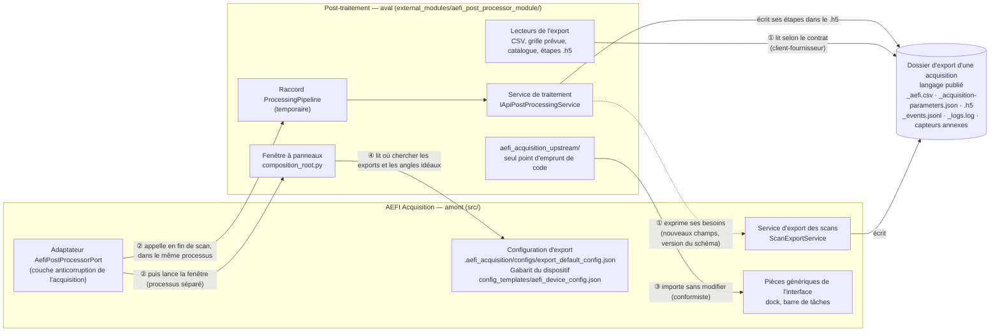
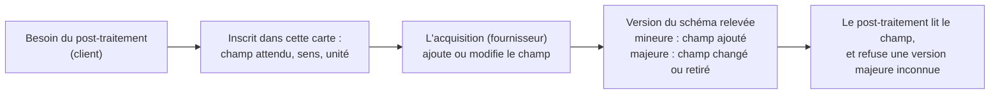
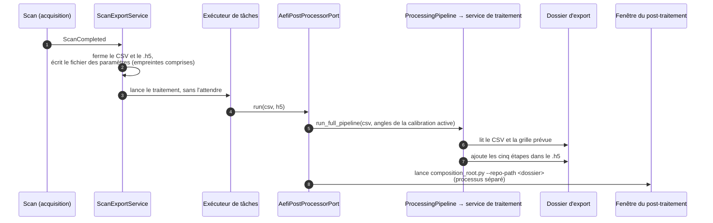

# Carte des contextes — AEFI Acquisition et post-traitement

Les liens entre le logiciel d'acquisition (`src/`) et le post-traitement (`external_modules/aefi_post_processor_module/`), tels qu'ils existent dans le code au 2026-11-16, et la cible quand elle diffère.
Relevée sur `develop` au commit `83b6fb4b`. Elle complète la carte de toute la suite logicielle (`inbox/AEFI_SOFTWARE_SUITE_CONTEXT_MAP.md`), qui reste au niveau des cinq contextes et ne détaille pas ces deux-là.

La relation voulue est décrite dans la conception du post-traitement (`_system/ops/traces/post-traitement-conforme/2026-11-12-concevoir-l-architecture-par-panneaux/conception - post-traitement en panneaux.md`, § 1). Cette carte dit ce qui est en place, ce qui ne l'est pas encore, et où les deux logiciels divergent aujourd'hui.

**Décision de l'humain (2026-11-16) :** le fichier des paramètres d'acquisition est un **contrat entre les deux logiciels, en relation client-fournisseur**. Le post-traitement est le client, l'acquisition le fournisseur : un besoin du post-traitement peut faire évoluer l'acquisition et son export. Cette décision remplace, pour ce fichier, le conformisme de la conception (§ 1.1), où le post-traitement prenait l'export tel quel sans rien pouvoir demander. Le code emprunté (lien ③) reste conformiste.

## 1. Vue d'ensemble

Deux contextes bornés, et quatre liens.

| Lien | Sens | Motif | En place |
|---|---|---|---|
| ① Dossier d'export, contrat porté par le fichier des paramètres | l'acquisition écrit, le post-traitement lit ; les besoins remontent du post-traitement vers l'acquisition | client-fournisseur : le post-traitement client, l'acquisition fournisseur | en partie : le CSV et la grille prévue sont lus, pas encore l'objet ni les angles |
| ② Appel en fin de scan | l'acquisition appelle le post-traitement | l'acquisition est cliente du service du post-traitement ; son adaptateur est sa couche anticorruption | oui, par un raccord temporaire au lieu du service |
| ③ Code emprunté | le post-traitement importe du code de l'acquisition | conformiste, par un seul paquet | oui, 5 pièces de l'interface |
| ④ Configuration partagée | le post-traitement lit deux fichiers de configuration de l'acquisition | conformiste, dépendance au dossier de travail | oui |

## 2. Le dossier d'export et son contrat

Le contrat entre les deux logiciels est le dossier d'export d'une acquisition, pas le code de l'acquisition. Le fichier des paramètres d'acquisition en est le cœur : il décrit l'acquisition et chacun des autres fichiers (`data.files`, avec leurs empreintes, et `data.columns`, le sens de chaque colonne du CSV).

### Comment fonctionne le contrat client-fournisseur

- Un besoin du post-traitement se dit d'abord ici, dans le tableau « Ce que le post-traitement attend » plus bas : le champ, son sens, son unité, et pourquoi.
- L'acquisition l'ajoute à son export et relève la version du schéma (`schema.version`) : version mineure pour un champ ajouté, majeure pour un champ changé ou retiré.
- Le post-traitement ne lit que des champs inscrits au contrat. Il accepte les versions mineures, refuse une version majeure inconnue et la nomme dans son journal.
- Les anciennes acquisitions restent lisibles : un champ ajouté par une version récente manque dans un fichier ancien, et le post-traitement le dit (par exemple, la grille carrée faute de grille prévue).

### Ce que le post-traitement attend du fichier des paramètres

| Champ | Pour quoi | Depuis le schéma | Lu |
|---|---|---|---|
| `procedure.step_scan.zone`, `procedure.step_scan.grid` | la grille prévue : distinguer un scan rectangulaire d'un scan interrompu | 1.0 | oui, depuis le 2026-11-16 |
| `measurement_chain.sensor.deployment.rotation_applied` (angles, convention, origine) | traiter avec les angles réellement appliqués | présent en 1.4 | tranche 2 |
| `provenance.activity.id` | l'identité de l'acquisition | présent en 1.4 | tranche 2 |
| `feature_of_interest` (objet, lift-off) | nommer l'objet mesuré dans la fenêtre | présent en 1.4 | tranche 2 |
| `data.columns` | vérifier le sens des colonnes du CSV | présent en 1.4 | prévu par la conception |
| `data.files`, empreinte du CSV | prouver de quelles données brutes dérive le fichier d'étapes | présent en 1.4 | tranche 2 (§ 6) |

### Les fichiers du dossier

| Fichier | Écrit par | Lu par le post-traitement | Ce qui en est lu | Où, côté post-traitement |
|---|---|---|---|---|
| `<acquisition>_aefi.csv` | acquisition | oui | positions `x`, `y` (mm) et les six tensions (en phase, quadrature, par axe) | `infrastructure/csv_scan_reader/` |
| `<acquisition>_acquisition-parameters.json` (schéma `aefi-acquisition-parameters` 1.0 à 1.4) | acquisition | oui, en partie | la grille prévue (`procedure.step_scan.zone` et `.grid`) depuis le 2026-11-16 | `infrastructure/acquisition_parameters_scan_plan_reader/` |
| `<acquisition>.h5` | acquisition (données brutes), puis post-traitement (étapes) jusqu'à la tranche 2 | oui | les étapes rangées, pour la carte et l'état du catalogue | `infrastructure/hdf5_step_writer/`, `hdf5_step_reader/`, `export_folder_repository/` |
| `<acquisition>_processing-steps.h5` (tranche 2) | post-traitement seul | oui | ses étapes et leur provenance | mêmes adaptateurs, sur ce fichier |
| `<acquisition>_events.jsonl`, `_logs.log`, `_accelerometer.csv`, `_column-stabilization.csv` | acquisition | non | — | — |

Le catalogue des acquisitions (`export_folder_repository`) liste les dossiers posés directement dans le dossier d'export. Un dossier rangé dans un sous-dossier (`BACKGROUND/`, `METALLIC/`…) n'y apparaît pas, ni un balayage en fréquence.

Ce que la tranche 2 du plan « post-traitement conforme » doit encore lire dans le fichier des paramètres : l'identité de l'acquisition (`provenance.activity.id`), l'objet mesuré et le lift-off (`feature_of_interest`), et surtout les angles appliqués (`measurement_chain.sensor.deployment.rotation_applied`, avec leur convention et leur origine). Elle prolonge le lecteur de la grille prévue, derrière le même port.

## 3. L'acquisition appelle le post-traitement en fin de scan

- Seul un scan **terminé** (`ScanCompleted`) est traité. Un scan annulé ou en échec ne l'est pas : il apparaît « à recalculer » dans le catalogue.
- Le traitement tourne **dans le processus de l'acquisition**. L'acquisition importe donc le code du post-traitement. C'est pourquoi le domaine et l'application du post-traitement n'importent ni Qt ni le paquet d'emprunt : sinon l'acquisition importerait, à travers lui, sa propre interface. `_tests/architecture_test.py` du module le vérifie.
- La fenêtre s'ouvre dans un **processus séparé**, car une seconde application Qt ne peut pas tourner dans la première.
- Côté acquisition, le port `IPostProcessingPort` (`src/application/scan/scan_export_service/ports/i_post_processing_port.py`) ne connaît que « traiter ces deux fichiers ». Son adaptateur `src/infrastructure/aefi_post_processor_port/aefi_post_processor_port.py` est le seul endroit de l'acquisition qui connaît le post-traitement.
- Cible : l'adaptateur appelle `IApiPostProcessingService`, l'entrée publique du post-traitement, au lieu du raccord `processing/processing_pipeline.py` (marqué `ponytail:`), qui garde l'ancienne signature.

## 4. Le code emprunté

Le post-traitement réutilise des pièces de l'acquisition plutôt que de les recopier, et seulement par `aefi_acquisition_upstream/`. Son intention tient la liste à jour.

| Objet | Source dans `src/` | Emprunté |
|---|---|---|
| `WindowsCarrier`, `CarrierPresentationModel` | `interface/widgets/carrier/`, `interface/presentation/` | oui |
| `ModernTaskbar`, `TaskbarPresenter`, `TaskbarPresentationModel` | `interface/widgets/taskbar/`, `interface/presenters/`, `interface/presentation/` | oui |
| `RotationConvention` | `domain/test_bench/calibration/value_objects/rotation_convention/` | tranche 2 |
| `BenchReferential` | `interface/presentation/bench_referential.py` | tranche 3 |
| `ScanVisualizationPanel` | `interface/widgets/panels/` | tranche 4 |

Règle : seuls les objets sans dépendance vers un service, un port ou un adaptateur de l'acquisition s'empruntent. Un changement de ces pièces dans `src/` se répercute dans la fenêtre du post-traitement : c'est le prix assumé du conformisme.

Conséquence pour le travail en parallèle : une modification de `src/interface/widgets/carrier/windows_carrier.py` (par exemple les panneaux détachés visibles dans Alt+Tab, plan `verrou-de-fermeture-et-fenetres-detachees`) change aussi la fenêtre du post-traitement. Elle se vérifie dans les deux fenêtres.

## 5. La configuration partagée

| Fichier de l'acquisition | Lu par le post-traitement pour | Où |
|---|---|---|
| `.aefi_acquisition/configs/export_default_config.json` | `output_directory` : le dossier d'export ouvert par défaut | `composition_root.py` |
| `config_templates/aefi_device_config.json` | les angles idéaux du capteur, utilisés par le bouton « Traiter » | `composition_root.py` |

Les deux chemins partent de la racine du dépôt : la fenêtre ne trouve la configuration que lancée depuis la copie du dépôt qui tient ces fichiers (`launch/launch_post_processor.bat`, ou l'adaptateur de l'acquisition).

## 6. Où les deux logiciels divergent aujourd'hui

**Les angles de rotation dépendent du chemin de traitement.**
En fin de scan, l'acquisition traite avec les angles de la calibration active (pour le scan de la bouteille d'eau du 13 novembre : 34,9°, 45,7°, −5,3°, calibrés).
Le bouton « Traiter » de la fenêtre retraite avec les angles idéaux du gabarit (35,3°, 45°, 0°).
Un scan retraité depuis la fenêtre change donc d'étape « repère tourné » et d'interpolation.
Décidé (2026-11-16) : corrigé en tranche 2, en lisant `rotation_applied` dans le fichier des paramètres de chaque acquisition. Le champ est déjà exporté : rien à demander à l'acquisition.

**L'empreinte du `.h5` ne vaut plus après le traitement.**
L'acquisition prend l'empreinte (taille, SHA-256) du `.h5` en fin de scan et l'écrit dans le fichier des paramètres, puis le post-traitement y ajoute ses étapes.
Pour le scan de la bouteille d'eau : 2 455 328 octets enregistrés, 6 046 209 octets aujourd'hui.
Un lecteur qui vérifie les empreintes conclurait à un fichier altéré.
Décidé (2026-11-16, choix laissé à l'agent par l'humain) : en tranche 2, le post-traitement range ses étapes dans **son propre fichier**, `<acquisition>_processing-steps.h5`, dans le dossier de l'acquisition, et n'écrit plus jamais dans `<acquisition>.h5`.

- Les données brutes et leur empreinte restent telles que l'acquisition les a enregistrées : un fichier écrit par un logiciel n'est modifié par aucun autre.
- Le fichier d'étapes porte sa propre provenance : le CSV source, son empreinte SHA-256 (comparable à celle de `data.files`) et l'identité de l'acquisition (`provenance.activity.id`). Un lecteur sait de quelles données brutes il dérive sans que l'acquisition le connaisse.
- L'acquisition ne déclare pas ce fichier dans `data.files` : elle écrit son fichier des paramètres avant le traitement, et ne pourrait ni en donner l'empreinte ni garantir qu'il existera. Le contrat n'a donc pas à changer de version pour ce point.
- Côté acquisition, seul l'adaptateur `AefiPostProcessorPort` change : il ne passe plus le chemin du `.h5` brut comme sortie du traitement.
- Les acquisitions déjà traitées gardent dans leur `.h5` les étapes ajoutées avant la tranche 2, et une empreinte qui ne correspond plus ; on n'y touche pas. Elles apparaissent « à recalculer » jusqu'à ce qu'un « Traiter » écrive leur fichier d'étapes.

**Le dossier d'export ne dit pas encore le sens de toutes ses colonnes au post-traitement.**
Le fichier des paramètres décrit chaque colonne du CSV (`data.columns`, unités et repères), mais le lecteur de CSV lit les colonnes par leur nom, sans les vérifier contre cette description. Prévu par la conception (§ 1.1).

## 7. Qui change quand

| Changement côté acquisition | Effet côté post-traitement |
|---|---|
| champ ajouté au fichier des paramètres (version mineure) | rien, jusqu'à ce que le post-traitement l'inscrive au contrat et le lise |
| nouvelle version majeure du schéma des paramètres | à annoncer au client avant de la publier ; refus attendu de l'acquisition dans le catalogue (« format non pris en charge »), une fois la tranche 2 faite ; aujourd'hui seule la grille est lue, et un fichier sans grille fait revenir à la grille carrée |
| colonne renommée dans `_aefi.csv` | le canal disparaît du traitement |
| pièce empruntée déplacée ou modifiée dans `src/interface/` | `aefi_acquisition_upstream/` casse à l'import, ou la fenêtre change |
| nouveau type d'acquisition exporté (balayage en fréquence, lecture continue) | invisible dans le catalogue tant que le post-traitement ne le traite pas |
| signature de `IPostProcessingPort` | seul l'adaptateur de l'acquisition change |
