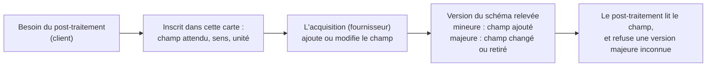
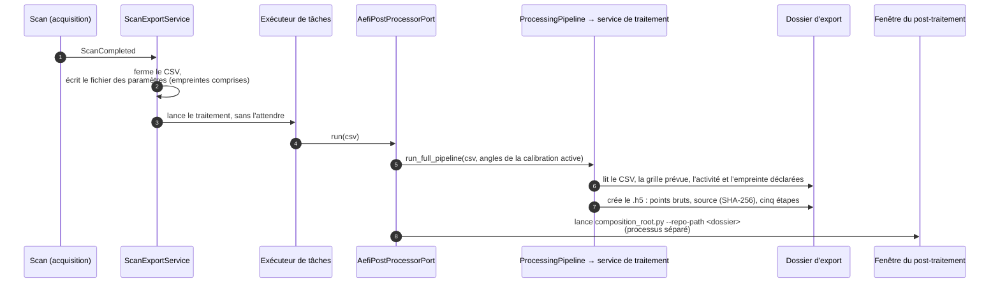
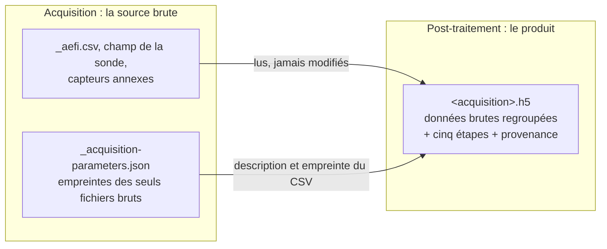

# Carte des contextes — AEFI Acquisition et post-traitement

Les liens entre le logiciel d'acquisition (`src/`) et le post-traitement (`external_modules/aefi_post_processor_module/`), tels qu'ils existent dans le code au 2026-11-16, et la cible quand elle diffère.
Relevée sur `develop` au commit `83b6fb4b`. Elle complète la carte de toute la suite logicielle (`inbox/AEFI_SOFTWARE_SUITE_CONTEXT_MAP.md`), qui reste au niveau des cinq contextes et ne détaille pas ces deux-là.

La relation voulue est décrite dans la conception du post-traitement (`_system/ops/traces/post-traitement-conforme/2026-11-12-concevoir-l-architecture-par-panneaux/conception - post-traitement en panneaux.md`, § 1). Cette carte dit ce qui est en place, ce qui ne l'est pas encore, et où les deux logiciels divergent aujourd'hui.

**Décision de l'humain (2026-11-16) :** le fichier des paramètres d'acquisition est un **contrat entre les deux logiciels, en relation client-fournisseur**. Le post-traitement est le client, l'acquisition le fournisseur : un besoin du post-traitement peut faire évoluer l'acquisition et son export. Cette décision remplace, pour ce fichier, le conformisme de la conception (§ 1.1), où le post-traitement prenait l'export tel quel sans rien pouvoir demander. Le code emprunté (lien ③) reste conformiste.

## 1. Vue d'ensemble

Deux contextes bornés, et quatre liens.

| Lien | Sens | Motif | En place |
|---|---|---|---|
| ① Dossier d'export, contrat porté par le fichier des paramètres | l'acquisition écrit, le post-traitement lit ; les besoins remontent du post-traitement vers l'acquisition | client-fournisseur : le post-traitement client, l'acquisition fournisseur | en partie : le CSV et la grille prévue sont lus, pas encore l'objet ni les angles |
| ② Appel en fin de scan | l'acquisition appelle le post-traitement | l'acquisition est cliente du service du post-traitement ; son adaptateur est sa couche anticorruption | oui, par un raccord temporaire au lieu du service |
| ③ Code emprunté | le post-traitement importe du code de l'acquisition | conformiste, par un seul paquet | oui, 5 pièces de l'interface |
| ④ Configuration partagée | le post-traitement lit deux fichiers de configuration de l'acquisition | conformiste, dépendance au dossier de travail | oui |

## 2. Le dossier d'export et son contrat

Le contrat entre les deux logiciels est le dossier d'export d'une acquisition, pas le code de l'acquisition. Le fichier des paramètres d'acquisition en est le cœur : il décrit l'acquisition et chacun des autres fichiers (`data.files`, avec leurs empreintes, et `data.columns`, le sens de chaque colonne du CSV).

### Comment fonctionne le contrat client-fournisseur

- Un besoin du post-traitement se dit d'abord ici, dans le tableau « Ce que le post-traitement attend » plus bas : le champ, son sens, son unité, et pourquoi.
- L'acquisition l'ajoute à son export et relève la version du schéma (`schema.version`) : version mineure pour un champ ajouté, majeure pour un champ changé ou retiré. Un champ qu'aucun lecteur ne lit (tableaux ci-dessous) se retire en version mineure.
- Le post-traitement ne lit que des champs inscrits au contrat. Il accepte les versions mineures, refuse une version majeure inconnue et la nomme dans son journal.
- Les anciennes acquisitions restent lisibles : un champ ajouté par une version récente manque dans un fichier ancien, et le post-traitement le dit (par exemple, la grille carrée faute de grille prévue).

### Ce que le post-traitement attend du fichier des paramètres

| Champ | Pour quoi | Depuis le schéma | Lu |
|---|---|---|---|
| `procedure.step_scan.zone`, `procedure.step_scan.grid` | la grille prévue : distinguer un scan rectangulaire d'un scan interrompu | 1.0 | oui, depuis le 2026-11-16 |
| `measurement_chain.sensor.deployment.rotation_applied` (angles, convention, origine) | traiter avec les angles réellement appliqués | présent en 1.4 | oui, depuis le 2026-11-19 (tranche 2, partie 1) |
| `provenance.activity.id` | l'identité de l'acquisition, consignée dans le `.h5` | présent en 1.4 | oui, depuis le 2026-11-19 (tranche 2, partie 2) |
| `feature_of_interest` (objet, lift-off) | nommer l'objet mesuré dans la fenêtre | présent en 1.4 | oui, depuis le 2026-11-19 (tranche 2, partie 1) |
| `data.columns` | vérifier le sens des colonnes du CSV | présent en 1.4 | prévu par la conception |
| `data.files`, empreinte du CSV | prouver de quelles données brutes dérive le `.h5` : le `.h5` consigne l'empreinte qu'il a lue et celle-ci, et dit si elles sont égales | présent en 1.4 | oui, depuis le 2026-11-19 (tranche 2, partie 2) |
| `data.files` sans `.h5` | le `.h5` n'est plus un fichier brut de l'acquisition | **1.7**, publiée par l'acquisition le 2026-11-19 | rien à lire : l'entrée disparaît |

### Qui lit chaque champ du fichier des paramètres

Un champ que personne ne lit se voit ici tout de suite. `measurement_uncertainty` serait apparu comme tel.

| Champ | Lu par | Dit quoi |
|---|---|---|
| `schema.version` | post-traitement (la version, comparée comme un tuple) | la version du contrat |
| `procedure.step_scan.zone`, `.grid` | post-traitement | demandé : la grille prévue |
| `procedure.step_scan.averaging_per_position` | personne aujourd'hui | demandé : le nombre d'échantillons moyennés par point |
| `std_dev_*` (colonnes de `_aefi.csv`, décrites par `data.columns`) | les chercheurs, à l'analyse | mesuré : la dispersion de chaque point, calculée sur `averaging_per_position` échantillons |
| `feature_of_interest` (objet, lift-off) | post-traitement (catalogue, panneau « Paramètres d'acquisition ») | saisi par l'opérateur à l'export |
| `measurement_chain.sensor.deployment.rotation_applied` | post-traitement (traducteur du catalogue, puis service de traitement) | les angles de la calibration appliqués par l'acquisition |
| `provenance.activity.id`, `data.files[<CSV>].sha256` | post-traitement (lecteur de provenance, consigné dans le `.h5`) | l'identité de l'acquisition et l'empreinte du CSV à sa fermeture |
| `procedure.step_scan.measurement_uncertainty` | **retiré en 1.5** ; personne ne le lisait | c'était un seuil par défaut de 0,001 V codé en dur, jamais appliqué ; il se lisait à tort comme une incertitude mesurée |

### Un champ exporté dit s'il est mesuré, demandé ou par défaut

Règle posée le 2026-11-19. Chaque champ du fichier des paramètres est l'un des trois :

- **mesuré** : sorti d'un instrument ou calculé sur des mesures (`std_dev_*`) ;
- **demandé** : la consigne de l'opérateur ou de la config (la grille, le nombre de moyennes, le lift-off) ;
- **par défaut** : une valeur que personne n'a choisie. Elle ne s'exporte pas sous un nom qui la ferait passer pour une mesure ou une consigne : on la retire, ou on la nomme et on en dit l'origine.

Le seuil d'incertitude enfreignait la règle : un défaut exporté comme une incertitude, 4 à 20 fois au-dessus de la dispersion réelle par point (0,06 à 0,30 mV).

### Les lecteurs hors des deux logiciels

Le fichier des paramètres n'est pas lu que par le post-traitement. Le graphe de la thèse reprend des champs de l'acquisition :

| Lecteur | Ce qu'il reprenait | Ce qui a été décidé |
|---|---|---|
| type `scan` de GRAPHE-THESE (`_system/self/type/scan.type.yaml`) | `measurement_uncertainty_max_V`, champ obligatoire, traduit tel quel du champ du logiciel sans demander s'il était mesuré | champ retiré du type le 2026-11-19 (option A) ; aucune configuration typée `scan` n'existait |
| JSON déjà publiés en 1.4 (par exemple dans `AEFI-THESIS-DATA-EXPERIMENTAL/acquisitions/`) | `measurement_uncertainty` = 0,001 V | non modifiés ; les fichiers 1.0 à 1.4 ne se lisent pas comme une mesure |

C'est un lien du fournisseur (l'acquisition) vers la couche de données, que la carte ne montrait pas. Un champ ajouté ou retiré du fichier se vérifie donc aussi contre ces lecteurs.

### Les fichiers du dossier

| Fichier | Écrit par | Lu par le post-traitement | Ce qui en est lu | Où, côté post-traitement |
|---|---|---|---|---|
| `<acquisition>_aefi.csv` | acquisition | oui | positions `x`, `y` (mm) et les six tensions (en phase, quadrature, par axe) | `infrastructure/csv_scan_reader/` |
| `<acquisition>_acquisition-parameters.json` (schéma `aefi-acquisition-parameters` 1.0 à 1.7) | acquisition | oui, en partie | la grille prévue (`procedure.step_scan.zone` et `.grid`), l'objet mesuré, le lift-off, les angles appliqués, la version du schéma, l'identité de l'acquisition et l'empreinte du CSV | `infrastructure/acquisition_parameters_scan_plan_reader/`, `acquisition_provenance_reader/`, `export_folder_repository/acl/` |
| `<acquisition>.h5` | post-traitement seul, depuis le 2026-11-19 (points bruts relus du CSV, cinq étapes, provenance) ; les acquisitions antérieures gardent un `.h5` écrit par l'acquisition, que le post-traitement complète | oui | les étapes rangées, pour la carte et l'état du catalogue | `infrastructure/hdf5_step_writer/`, `hdf5_step_reader/`, `export_folder_repository/` |
| `<acquisition>_logs.log.xz`, `_accelerometer.csv.xz` (archives écrites à l'arrêt du scan), `_column-stabilization.csv` ; plus de `_events.jsonl` depuis le schéma 1.6 | acquisition | non | — | — |

Le catalogue des acquisitions (`export_folder_repository`) liste les dossiers posés directement dans le dossier d'export. Un dossier rangé dans un sous-dossier (`BACKGROUND/`, `METALLIC/`…) n'y apparaît pas, ni un balayage en fréquence.

La tranche 2 du plan « post-traitement conforme » a fait lire dans le fichier des paramètres l'objet mesuré et le lift-off (`feature_of_interest`), les angles appliqués (`measurement_chain.sensor.deployment.rotation_applied`, avec leur convention et leur origine) par le catalogue, et l'identité de l'acquisition (`provenance.activity.id`) avec l'empreinte du CSV (`data.files`) par un lecteur de provenance, derrière un port de plus.

## 3. L'acquisition appelle le post-traitement en fin de scan

- Seul un scan **terminé** (`ScanCompleted`) est traité. Un scan annulé ou en échec ne l'est pas : il apparaît « à recalculer » dans le catalogue.
- Le traitement tourne **dans le processus de l'acquisition**. L'acquisition importe donc le code du post-traitement. C'est pourquoi le domaine et l'application du post-traitement n'importent ni Qt ni le paquet d'emprunt : sinon l'acquisition importerait, à travers lui, sa propre interface. `_tests/architecture_test.py` du module le vérifie.
- La fenêtre s'ouvre dans un **processus séparé**, car une seconde application Qt ne peut pas tourner dans la première.
- Côté acquisition, le port `IPostProcessingPort` (`src/application/scan/scan_export_service/ports/i_post_processing_port.py`) ne connaît que « traiter ce CSV » (`run(csv_path)`) : le `.h5` se crée à côté, sous le nom du dossier. Son adaptateur `src/infrastructure/aefi_post_processor_port/aefi_post_processor_port.py` est le seul endroit de l'acquisition qui connaît le post-traitement.
- Cible : l'adaptateur appelle `IApiPostProcessingService`, l'entrée publique du post-traitement, au lieu du raccord `processing/processing_pipeline.py` (marqué `ponytail:`), qui garde l'ancienne signature.
- Depuis le 2026-11-19 (tranche 2) : l'acquisition ne ferme plus de `.h5` en fin de scan ; elle passe le seul CSV au traitement, qui crée le `.h5` (§ 6).

## 4. Le code emprunté

Le post-traitement réutilise des pièces de l'acquisition plutôt que de les recopier, et seulement par `aefi_acquisition_upstream/`. Son intention tient la liste à jour.

| Objet | Source dans `src/` | Emprunté |
|---|---|---|
| `WindowsCarrier`, `CarrierPresentationModel` | `interface/widgets/carrier/`, `interface/presentation/` | oui |
| `ModernTaskbar`, `TaskbarPresenter`, `TaskbarPresentationModel` | `interface/widgets/taskbar/`, `interface/presenters/`, `interface/presentation/` | oui |
| `RotationConvention` | `domain/test_bench/calibration/value_objects/rotation_convention/` | tranche 2 |
| `BenchReferential` | `interface/presentation/bench_referential.py` | tranche 3 |
| `ScanVisualizationPanel` | `interface/widgets/panels/` | tranche 4 |

Règle : seuls les objets sans dépendance vers un service, un port ou un adaptateur de l'acquisition s'empruntent. Un changement de ces pièces dans `src/` se répercute dans la fenêtre du post-traitement : c'est le prix assumé du conformisme.

Conséquence pour le travail en parallèle : une modification de `src/interface/widgets/carrier/windows_carrier.py` (par exemple les panneaux détachés visibles dans Alt+Tab, plan `verrou-de-fermeture-et-fenetres-detachees`) change aussi la fenêtre du post-traitement. Elle se vérifie dans les deux fenêtres.

## 5. La configuration partagée

| Fichier de l'acquisition | Lu par le post-traitement pour | Où |
|---|---|---|
| `.aefi_acquisition/configs/export_default_config.json` | `output_directory` : le dossier d'export ouvert par défaut | `composition_root.py` |
| `config_templates/aefi_device_config.json` | les angles idéaux du capteur, utilisés par le bouton « Traiter » | `composition_root.py` |

Les deux chemins partent de la racine du dépôt : la fenêtre ne trouve la configuration que lancée depuis la copie du dépôt qui tient ces fichiers (`launch/launch_post_processor.bat`, ou l'adaptateur de l'acquisition).

## 6. Où les deux logiciels divergent aujourd'hui

**Les angles de rotation dépendent du chemin de traitement.**
En fin de scan, l'acquisition traite avec les angles de la calibration active (pour le scan de la bouteille d'eau du 13 novembre : 34,9°, 45,7°, −5,3°, calibrés).
Le bouton « Traiter » de la fenêtre retraite avec les angles idéaux du gabarit (35,3°, 45°, 0°).
Un scan retraité depuis la fenêtre change donc d'étape « repère tourné » et d'interpolation.
**Corrigé** (2026-11-19, tranche 2, partie 1) : le catalogue lit `rotation_applied` dans le fichier des paramètres de chaque acquisition, et le bouton « Traiter » retraite avec ces angles ; sans description, ou si l'acquisition a déjà tourné ses valeurs ou utilise une convention inconnue, il retombe sur les angles idéaux et le dit (panneau « Paramètres d'acquisition », journal).

**L'empreinte du `.h5` ne vaut plus après le traitement. Corrigé** (2026-11-19, tranche 2, partie 2).
L'acquisition prend l'empreinte (taille, SHA-256) du `.h5` en fin de scan et l'écrit dans le fichier des paramètres, puis le post-traitement y ajoute ses étapes.
Pour le scan de la bouteille d'eau : 2 455 328 octets enregistrés, 6 046 209 octets aujourd'hui.
Un lecteur qui vérifie les empreintes conclurait à un fichier altéré.
Décidé par l'humain (2026-11-16) et appliqué : **l'acquisition n'exporte plus que des CSV, et le `.h5` devient un produit du traitement.** Le post-traitement y regroupe tout : les données brutes relues des CSV et ses cinq étapes.

- Le CSV est la seule source brute. Le fichier des paramètres ne donne d'empreinte qu'à des fichiers que l'acquisition a écrits et que personne ne modifie ensuite : le problème d'empreinte disparaît.
- Le `.h5` se refait à tout moment depuis les CSV : un nouveau traitement, ou un traitement corrigé, le réécrit en entier.
- Le `.h5` porte sa provenance : le CSV source, son empreinte (comparable à celle du fichier des paramètres) et l'identité de l'acquisition (`provenance.activity.id`).
- Rien ne se perd : le `.h5` que l'acquisition écrivait ne tenait que les points du scan, les points de la sonde de champ et des attributs de configuration, déjà présents dans les CSV et le fichier des paramètres. Vérifié au codage : les attributs de configuration d'un scan pas à pas ou à la volée sont tous dans le fichier des paramètres ; le scan en ligne n'était déjà pas exporté. Le `.h5` du post-traitement reprend les points du seul `_aefi.csv` : ceux de la sonde de champ restent dans leur CSV d'accompagnement.
- C'est le premier besoin du client envers son fournisseur, satisfait : `Hdf5ScanExportPort` est retiré, le traitement part du seul CSV (`IPostProcessingPort.run(csv_path)`), et le schéma passe en **1.7** (`data.files` ne liste plus de `.h5`).
- Les acquisitions déjà exportées gardent dans leur fichier des paramètres l'empreinte d'un `.h5` écrit par l'acquisition, qui ne correspond plus. Un nouveau traitement réécrit ce `.h5` à partir des CSV, sans perte, et leur empreinte reste fausse : c'est une limite connue des exports antérieurs à ce changement.

**Le dossier d'export ne dit pas encore le sens de toutes ses colonnes au post-traitement.**
Le fichier des paramètres décrit chaque colonne du CSV (`data.columns`, unités et repères), mais le lecteur de CSV lit les colonnes par leur nom, sans les vérifier contre cette description. Prévu par la conception (§ 1.1).

## 7. Qui change quand

| Changement côté acquisition | Effet côté post-traitement |
|---|---|
| champ ajouté au fichier des paramètres (version mineure) | rien, jusqu'à ce que le post-traitement l'inscrive au contrat et le lise |
| nouvelle version majeure du schéma des paramètres | à annoncer au client avant de la publier ; refus attendu de l'acquisition dans le catalogue (« format non pris en charge »), à confirmer : le catalogue ne refuse pas encore une version majeure inconnue ; un fichier sans grille fait revenir à la grille carrée |
| champ retiré du fichier des paramètres | version mineure si aucun lecteur ne le lit (§ 2, « Qui lit chaque champ »), comme `measurement_uncertainty` en 1.5 ; sinon version majeure annoncée au client avant publication. Vérifier aussi les lecteurs hors des deux logiciels (type `scan` du graphe) |
| colonne renommée dans `_aefi.csv` | le canal disparaît du traitement |
| pièce empruntée déplacée ou modifiée dans `src/interface/` | `aefi_acquisition_upstream/` casse à l'import, ou la fenêtre change |
| nouveau type d'acquisition exporté (balayage en fréquence, lecture continue) | invisible dans le catalogue tant que le post-traitement ne le traite pas |
| signature de `IPostProcessingPort` (`run(csv_path)`) | seul l'adaptateur de l'acquisition change |
