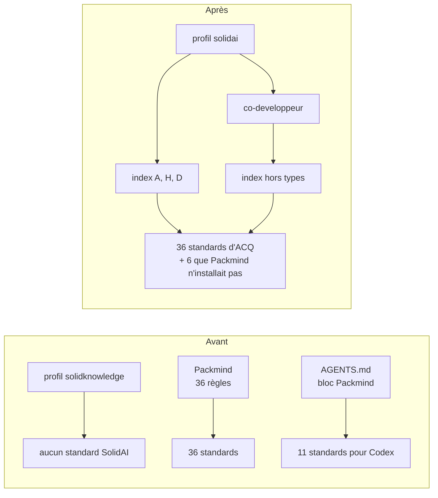

# Rapport de conformité SolidAI d'AEFI_Acquisition

AEFI_Acquisition peut passer au profil `solidai` sans perdre un standard : ses 36 règles Packmind ont toutes un foyer dans le profil.
Le rapport ne pose aucune question nouvelle : chaque décision est déjà prise par l'humain.

Phase 1 du skill `mettre-en-conformite-solidai`, en lecture seule, au commit `790b505` de `develop`.
Elle reprend le rapport du 2026-11-11 (`AEFI_Distribution_Des_Jobs/_system/ops/traces/2026-11-11-mettre-en-conformite-solidai/rapport-de-conformite-aefi-acquisition.md`) et ne vérifie que ce qui a changé depuis.

Le profil `solidai` sert les 29 standards déjà couverts le 2026-11-11.
Les 7 standards Qt sans foyer sont entrés dans `solidai-developpement/standards/`, généralisés à toute interface :
- 6 au commit `c1fe7be`
- Humble Object au commit `78e963c`, avec A1 affiné dans `solidai-atome` `ea42780` (décision B)

Aucun fichier Packmind d'ACQ n'a changé depuis le 2026-11-11 : dernières dates au 2026-09-18, aucun commit sur ces chemins depuis `444ab4d`.

## 1. Ce qui changerait

**Profil.** Le profil actif, `solidknowledge`, est un profil de graphe de connaissance.
- Ajouter `_system/self/profiles/solidai.yaml`, aligné sur `solidai-developpement/profiles/solidai.yaml`
- Pointer `_system/ops/session-startup/profil-actif` sur `solidai`
- Garder `solidknowledge.yaml` pour une session de connaissance
- `co-inhabitant::GRAPHE-THESE` et `core-profile::au-writing-style` ne passent pas : `co-developpeur` et `voix::sk-writing-style` les remplacent pour du code
- Régénérer le sous-agent `au-aefi-acquisition` par `generer-agents-depuis-profils.sh`

**Deps à ajouter** : `sk-writing-style`, `solidai-developpement`, `solidai-verify`.

**Standards à copier dans le paquet** : aucun, les 7 y sont déjà.

**Fichiers Packmind à retirer** :

| Chemin | Suivi par git | Geste |
|---|---|---|
| `.claude/rules/packmind/` (36 règles) | 14 suivies sur 36 | `git rm` sur les 14, `rm` sur le reste |
| `.packmind/` (standards, commandes, `_drafts/`, index) | 33 suivis sur 55, malgré `.gitignore` | `git rm` sur les 33, `rm` sur le reste |
| Ligne `.packmind/` de `.gitignore` | oui | retirer la ligne |
| `packmind.json`, `packmind-lock.json` | oui | `git rm` |
| `AGENTS.md` : le bloc `Packmind standards` est tout le fichier | oui | `git rm` |

Correction du rapport du 2026-11-11 : `.packmind/` y figurait comme non suivi.

**`CLAUDE.md`** : aucun renvoi à Packmind ni à `.claude/rules/`, rien à réécrire.

## 2. Ce qui serait gardé

| Élément | Raison |
|---|---|
| Inject `orient-work::GRAPHE-THESE` | réglage de thèse : registre des travaux lu à l'ouverture |
| Registre `../../PILOTAGE/_system/ops/registre-des-travaux.md` | réglage de thèse : registre unique de PILOTAGE |
| `workspace.yaml` : GRAPHE-THESE et PILOTAGE en `edit` | réglage du dossier, hors standards |
| 31 deps en plus (projections au-host, `sk-weave`, `au-writing-style`, `GRAPHE-THESE`…) | venues du modèle de workspace ou résolvant un inject ; aucune ne casse rien |
| 7 commandes `.claude/commands/` | procédures, pas standards ; elles ne lisent pas `.packmind/` |
| `.claude/settings.json`, `.claude/hooks/`, `.mcp.json` | outillage du repo |
| `.claude/worktrees/` | hors champ |

## 3. Règles non couvertes

Aucune.
Aucune règle `[AGENT-WORK]` dans ce repo.
Deux points tranchés par l'humain s'appliquent tels quels :
- Unit of Work : le Fake reste près de son réel, dans l'infrastructure (H18, A13)
- Humble Object : une vue humble n'a pas de trio propre, ses tests vivent avec son presenter (A1 affiné)

## 4. Questions

Aucune question nouvelle.
Les décisions du 2026-11-11 et du 2026-11-12 valent validation : passage au profil `solidai`, deps de la référence, retrait de Packmind, `src/` intact.

Hors champ : le typage SolidAI des intentions de `src/` (règle A20) reste un chantier à part.
