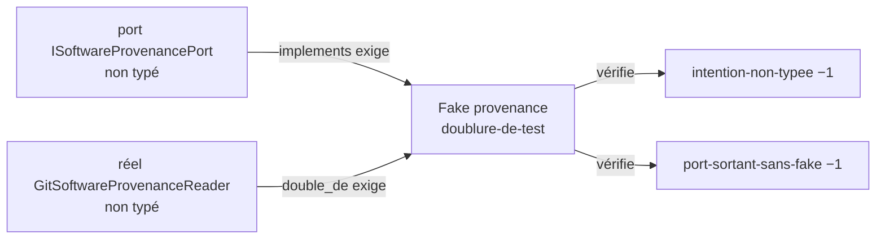
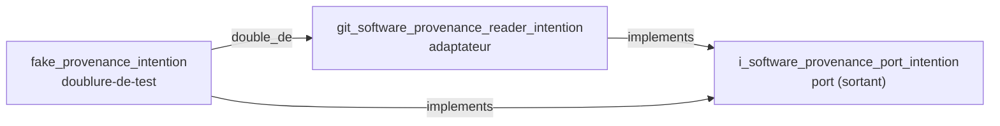

# Audit des trois exemples de mise en conformité d'ACQ

1. **Exemple 3, Fake mal placé : fait.** `solidai verify` passe de 1 314 à 1 313 erreurs, seul `solidai-fake-mal-place` baisse (26 → 25), aucun code nouveau ; tests identiques (1 707 réussis, 3 sautés, 0 échec).
2. **Exemples 1 et 2, typage d'un Fake : non faits.** Typer une intention de Fake en `doublure-de-test` ajoute une erreur moteur, car le type exige `implements` vers un port typé et `double_de` vers un adaptateur typé, et ACQ n'en a aucun.
3. **À trancher** : autoriser un exemple en chaîne sur la provenance (port, puis réel `adaptateur`, puis Fake `doublure-de-test`), qui touche trois intentions au lieu d'une.



Les exemples 1 et 2 tombent ensemble : typer le Fake fait disparaître les deux erreurs.
Mais le moteur refuse un Fake typé sans ses deux cibles typées : c'est l'erreur `required-field-absent` sur `implements`.
La brique du geste, `creer-un-atome.sh` rôle `fake`, refuse pour la même raison.

## Exemple 1 : une intention de Fake typée `doublure-de-test`

- **Règle et source** : A20, toute intention porte un type SolidAI (solidai-atome, vérification `solidai-intention-non-typee`) ; le type `doublure-de-test::solidai-hexagonal` (F4).
- **Erreur avant** : `src/infrastructure/provenance/fake/fake_software_provenance_port_intention.md` : « claims no SolidAI type: the checks do not see it ».
- **Commit** : aucun.
- **Pourquoi** : `au_validate` du frontmatter candidat (type, `tldr`, `code`, `cause_de_changement: outil`, `double_de`) rend `required-field-absent` sur `implements`, une erreur. `au_instances_of` compte 0 `adaptateur` et 0 `port` dans ACQ.
- **Tests** : non relancés, aucun changement.
- Détail : `constat-typer-les-fakes-exige-de-typer-reels-et-ports.md`.

## Exemple 2 : un port sortant dont le Fake est typé

- **Règle et source** : H18 et R2 de solidai-verify, un port sortant a un Fake `doublure-de-test` qui l'implémente (vérification `solidai-port-sortant-sans-fake`, `role_queries.outgoing_ports_without_fake`).
- **Erreur visée** : `src/application/shared/acquisition_parameters/i_software_provenance_port.py` n'est pas dans la liste du tri ; le cas le plus lisible du tri est `i_event_log_storage_port.py:23` : « the outgoing port IEventLogStoragePort has no Fake: no doublure-de-test implements it ».
- **Commit** : aucun.
- **Pourquoi** : cette erreur ne tombe qu'en typant le Fake, donc avec le même blocage que l'exemple 1.
- **Tests** : non relancés, aucun changement.

## Exemple 3 : un Fake mal placé, renommé près de son réel

- **Règle et source** : H18, un Fake vit à `infrastructure/<adaptateur>/fake/fake_<adaptateur>.py` (solidai-hexagonal, `checks/domain/hexagonal_code.py`, `fake_misplaced`).
- **Cas choisi** : `provenance/`, l'un des deux dossiers d'infrastructure qui ne tiennent qu'un réel. Le Fake était déjà dans le `fake/` de son réel : seul son nom ne suivait pas le dossier. Les 24 autres cas exigent de déplacer le réel d'abord (`constat-fake-mal-place-exige-de-deplacer-les-reels.md`).
- **Erreur avant** : `src/infrastructure/provenance/fake/fake_software_provenance_port.py is not infrastructure/<adapter>/fake/fake_<adapter>.py`.
- **Erreur disparue** : oui, `solidai-fake-mal-place` 26 → 25 ; les 24 autres codes inchangés, au compte près.
- **Tests** : `pytest src`, 1 707 réussis, 3 sautés, 248 sous-tests, 0 échec, identique à la référence.

### Commits

Le gate a commité lui-même le renommage de l'intention et son titre ; le commit manuel porte le module et ses imports.

| Commit | Contenu |
|---|---|
| `edb7776` | renommage de l'intention, par le gate : `fake_software_provenance_port_intention.md` → `fake_provenance_intention.md` |
| `2ff40fd` | titre de l'intention, par le gate : `# fake_provenance — Intention` |
| `d3a6575` | « Renommer le Fake de provenance en fake_provenance, imports suivis — un exemple de fake-mal-place (H18) à auditer avant de réduire la dette SolidAI d'ACQ vers une garde --strict » |

### `git show --stat d3a6575`

```text
 .../_tests/acquisition_throughput_characterization_service_test.py      | 2 +-
 .../frequency_sweep_service/_tests/frequency_sweep_service_test.py      | 2 +-
 .../_tests/scan_export_closes_after_last_point_test.py                  | 2 +-
 .../scan_export_with_post_processing_integration_test.py                | 2 +-
 .../_tests/scan_fly_execution_integration_test.py                       | 2 +-
 .../services/scan_export_service/_tests/scan_export_service_test.py     | 2 +-
 src/infrastructure/persistence/_tests/__init__.py                       | 2 +-
 .../persistence/acquisition_throughput/_tests/__init__.py               | 2 +-
 .../_tests/acquisition_parameters_v1_serializer_test.py                 | 2 +-
 .../frequency_sweep/_tests/csv_frequency_sweep_export_port_test.py      | 2 +-
 .../{fake_software_provenance_port_test.py => fake_provenance_test.py}  | 2 +-
 .../fake/{fake_software_provenance_port.py => fake_provenance.py}       | 2 +-
 12 files changed, 12 insertions(+), 12 deletions(-)
```

### Diff

Le diff complet compte 161 lignes avec son contexte. Ses 12 changements sont les mêmes : 11 imports `infrastructure.provenance.fake.fake_software_provenance_port` → `infrastructure.provenance.fake.fake_provenance`, et la docstring du module :

```diff
-from infrastructure.provenance.fake.fake_software_provenance_port import FakeSoftwareProvenancePort
+from infrastructure.provenance.fake.fake_provenance import FakeSoftwareProvenancePort
-See fake_software_provenance_port_intention.md.
+See fake_provenance_intention.md.
```

La classe garde son nom, `FakeSoftwareProvenancePort` : la règle ne porte que sur le fichier.
Le diff du titre de l'intention (`2ff40fd`) tient en une ligne, ci-dessus.

### Ce que `boucle-tdd.sh` a dit

Il rend `CASSE` sur l'atome, à tort : il compte comme nouvelles les erreurs déjà présentes sur le fichier renommé (`fake-sans-test-de-contrat`, `infrastructure-importe-hors-des-ports`, R7), parce qu'il les compare par chemin.
Le verify complet montre qu'aucun compte n'a bougé hors `fake-mal-place`.
Un renommage le trompera à chaque fois ; c'est une piste de correction pour solidai-developpement.

## Exemple 1-2 : typage en chaîne de la provenance

1. **Fait, sauf le port pour `solidai verify`.** Les trois intentions sont typées et le moteur ne rend aucune erreur sur `src/`. `solidai verify` passe de 1 313 à 1 311 erreurs : seul `solidai-intention-non-typee` baisse (417 → 415), pour le réel et le Fake. Aucun code nouveau n'apparaît.
2. **Le graphe relie le Fake à son réel** : R3 rend la paire `FakeSoftwareProvenancePort → GitSoftwareProvenanceReader`. Avant, R3 était vide.
3. **Le port reste invisible pour `solidai verify`.** Il garde son erreur `intention-non-typee` et n'apparaît pas dans R1 ni dans R2. La raison est donnée plus bas, avec une décision à prendre.
4. **Tests identiques** : 1 707 réussis, 3 sautés, 0 échec.



L'ordre suit les dépendances du type : le moteur refuse un `implements` vers une note qui n'est pas un `port`, et un `double_de` vers une note qui n'est pas un `adaptateur`.
Chaque intention a d'abord été vérifiée par `au_validate`, verdict valide, puis par `au_diagnostics` sur le fichier, qui a rendu 0 diagnostic.
Aucun `.py` n'a changé.

### Le port : un type au niveau du fichier, faute de service pour l'héberger

- **Règle et source** : F2, un port dit son sens et son fichier (solidai-hexagonal, forme du type `port`). Le type prévoit un enregistrement inline dans l'intention du service qui consomme le port (question « Est-ce un contrat sans implémentation ? »).
- **Choix fait** : le type `port` est posé au niveau du fichier `i_software_provenance_port_intention.md`, sans enregistrement inline.
  Le port vit dans `application/shared/acquisition_parameters/` et trois services le consomment : `scan_export_service`, `frequency_sweep_service` et `acquisition_throughput_characterization_service`.
  Aucune intention de service ne peut donc l'héberger seule, et déplacer le `.py` était hors du périmètre.
  C'est la dette H2 déjà signalée, `solidai-port-sortant-mal-place`.
- **Erreur avant** : `solidai-intention-non-typee` sur `src/application/shared/acquisition_parameters/i_software_provenance_port_intention.md`, « claims no SolidAI type: the checks do not see it ».
- **Commit** : `2c88de9`.
- **Diff du frontmatter** :

```diff
+---
+type: port::solidai-hexagonal
+tldr: "Le port sortant qui lit la provenance du logiciel (nom, version, commit, branche, arbre modifié) pour l'exporter avec les paramètres d'acquisition."
+sens: sortant
+code: "[[src/application/shared/acquisition_parameters/i_software_provenance_port.py]]"
+---
 # i_software_provenance_port — Intention
```

- **Erreurs disparues** : aucune dans `solidai verify`.
  La vérification A20 (`solidai-intention-non-typee`) ne compte pas `port` dans sa liste de types SolidAI, déclarée dans `solidai-atome/checks/solidai-intention-non-typee.md`.
  Le graphe par rôle ne lit le sens d'un port que dans un enregistrement inline.
  Un type `port` posé sur un fichier y prend le rôle « port », ni sortant ni entrant, et le port ne figure donc pas dans R1.
- **Ce que le type apporte quand même** : il est la cible que le moteur exige pour `implements`. Sans lui, le réel et le Fake ne se typent pas.
- **À trancher** :
  - A. faire reconnaître par `solidai verify` un port typé au niveau du fichier, en lisant son `sens` comme pour un enregistrement ;
  - B. garder la doctrine (un port n'a pas d'intention propre) : déplacer le port dans un service, ou en faire un enregistrement inline dans l'intention d'un des trois services, puis supprimer cette intention.

### Le réel : `adaptateur`

- **Règle et source** : A20, toute intention porte un type SolidAI (solidai-atome). F3, un adaptateur implémente au moins un port (solidai-hexagonal, forme du type `adaptateur`). Question « Remplace-t-il un réel, ou implémente-t-il un port ? » : il implémente `ISoftwareProvenancePort`.
- **Erreur avant** : `solidai-intention-non-typee` sur `src/infrastructure/provenance/git_software_provenance_reader_intention.md`.
- **Commit** : `14b2a9a`.
- **Diff du frontmatter** :

```diff
+---
+type: adaptateur::solidai-hexagonal
+tldr: "Le lecteur réel de provenance : nom et version depuis pyproject.toml, commit, branche et arbre modifié depuis git, sans jamais lever d'exception."
+code: ["[[src/infrastructure/provenance/git_software_provenance_reader.py]]"]
+cause_de_changement: outil
+implements: ["[[src/application/shared/acquisition_parameters/i_software_provenance_port_intention]]"]
+---
 # git_software_provenance_reader — Intention
```

- **Erreurs disparues** : `solidai-intention-non-typee`, « git_software_provenance_reader_intention.md claims no SolidAI type ».
- **Erreurs restantes sur ce réel, hors périmètre** : `solidai-adaptateur-mal-place` (H16, le fichier ne s'appelle pas `provenance.py`), `solidai-infrastructure-importe-hors-des-ports` (A14, deux imports) et `solidai-adaptateur-construit-hors-composition` dans `src/main.py` (A12).

### Le Fake : `doublure-de-test`

- **Règle et source** : A20 (solidai-atome). F4, une doublure dit le réel qu'elle remplace (solidai-hexagonal, forme du type `doublure-de-test`). Selon H22, le Fake tient la même promesse que le réel : son `implements` est celui du réel.
- **Erreur avant** : `solidai-intention-non-typee` sur `src/infrastructure/provenance/fake/fake_provenance_intention.md`.
- **Commit** : `0250004`.
- **Diff du frontmatter** :

```diff
+---
+type: doublure-de-test::solidai-hexagonal
+tldr: "Le Fake de provenance : rend une provenance donnée, arbre propre ou git absent, pour que les tests ne dépendent pas de l'état du dépôt."
+code: ["[[src/infrastructure/provenance/fake/fake_provenance.py]]"]
+cause_de_changement: outil
+implements: ["[[src/application/shared/acquisition_parameters/i_software_provenance_port_intention]]"]
+double_de: "[[src/infrastructure/provenance/git_software_provenance_reader_intention]]"
+---
 # fake_provenance — Intention
```

- **Erreurs disparues** : `solidai-intention-non-typee`, « fake_provenance_intention.md claims no SolidAI type ».
- **Erreurs restantes sur ce Fake, hors périmètre** : `solidai-fake-sans-test-de-contrat` (H20) et `solidai-infrastructure-importe-hors-des-ports` (A14, deux imports).

### Tests et graphe

- **Tests avant** : 1 705 réussis, 2 échecs, 3 sautés.
  Les deux échecs sont instables, sans lien avec le changement : un débit ADC mesuré au chronomètre et un écart type de bruit aléatoire à 1,017 pour un seuil de 1.
  Relancés seuls trois fois, ils passent. La phase 1 avait mesuré 1 707 réussis.
- **Tests après** : 1 707 réussis, 3 sautés, 0 échec, identiques à la référence de la phase 1.
- **`solidai verify`** : 1 313 → 1 311 erreurs, 63 → 63 avertissements. Seul `solidai-intention-non-typee` change (417 → 415), et aucun code n'apparaît.
- **`solidai graphe` R1, R2, R3** :
  - R3 avant : `{"paires": {}}`. R3 après : `{"paires": {"FakeSoftwareProvenancePort": "GitSoftwareProvenanceReader"}, "orphelins": [], "hors_de_fake": []}`.
  - R1 et R2 ne listent `ISoftwareProvenancePort` ni avant ni après (voir la section sur le port).
- **Diagnostics du moteur** : 0 sur `src/`. Sur le repo, les 2 erreurs restent celles de la référence (`yaml-parse-error` dans `_system/promise_model/` et `_system/thoughts_interface/`).
- **Journaux** : `run-pytest-exemple-1-2-avant.log`, `run-pytest-exemple-1-2-apres.log`, `run-verify-exemple-1-2-avant.json`, `run-verify-exemple-1-2-apres.json`, `run-graphe-exemple-1-2-avant.txt`, `run-graphe-exemple-1-2-apres.txt`.

## Références

- Tests : `run-pytest-avant.log`, `run-pytest-exemple-3.log`
- Verify : `run-verify-avant.json`, `run-verify-exemple-3.json`
- Boucle TDD : `run-boucle-tdd-exemple-3-avant.log`, `run-boucle-tdd-exemple-3-apres.log`
- Tri après : `run-tri-apres-phase-1.txt`, résumé dans `plan-de-lots-acq-apres-phase-1.md`
