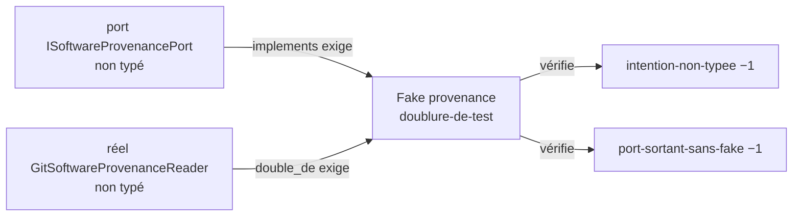

# Audit des trois exemples de mise en conformité d'ACQ

1. **Exemple 3, Fake mal placé : fait.** `solidai verify` passe de 1 314 à 1 313 erreurs, seul `solidai-fake-mal-place` baisse (26 → 25), aucun code nouveau ; tests identiques (1 707 réussis, 3 sautés, 0 échec).
2. **Exemples 1 et 2, typage d'un Fake : non faits.** Typer une intention de Fake en `doublure-de-test` ajoute une erreur moteur, car le type exige `implements` vers un port typé et `double_de` vers un adaptateur typé, et ACQ n'en a aucun.
3. **À trancher** : autoriser un exemple en chaîne sur la provenance (port, puis réel `adaptateur`, puis Fake `doublure-de-test`), qui touche trois intentions au lieu d'une.



Les exemples 1 et 2 tombent ensemble : typer le Fake fait disparaître les deux erreurs.
Mais le moteur refuse un Fake typé sans ses deux cibles typées : c'est l'erreur `required-field-absent` sur `implements`.
La brique du geste, `creer-un-atome.sh` rôle `fake`, refuse pour la même raison.

## Exemple 1 : une intention de Fake typée `doublure-de-test`

- **Règle et source** : A20, toute intention porte un type SolidAI (solidai-atome, vérification `solidai-intention-non-typee`) ; le type `doublure-de-test::solidai-hexagonal` (F4).
- **Erreur avant** : `src/infrastructure/provenance/fake/fake_software_provenance_port_intention.md` : « claims no SolidAI type: the checks do not see it ».
- **Commit** : aucun.
- **Pourquoi** : `au_validate` du frontmatter candidat (type, `tldr`, `code`, `cause_de_changement: outil`, `double_de`) rend `required-field-absent` sur `implements`, une erreur. `au_instances_of` compte 0 `adaptateur` et 0 `port` dans ACQ.
- **Tests** : non relancés, aucun changement.
- Détail : `constat-typer-les-fakes-exige-de-typer-reels-et-ports.md`.

## Exemple 2 : un port sortant dont le Fake est typé

- **Règle et source** : H18 et R2 de solidai-verify, un port sortant a un Fake `doublure-de-test` qui l'implémente (vérification `solidai-port-sortant-sans-fake`, `role_queries.outgoing_ports_without_fake`).
- **Erreur visée** : `src/application/shared/acquisition_parameters/i_software_provenance_port.py` n'est pas dans la liste du tri ; le cas le plus lisible du tri est `i_event_log_storage_port.py:23` : « the outgoing port IEventLogStoragePort has no Fake: no doublure-de-test implements it ».
- **Commit** : aucun.
- **Pourquoi** : cette erreur ne tombe qu'en typant le Fake, donc avec le même blocage que l'exemple 1.
- **Tests** : non relancés, aucun changement.

## Exemple 3 : un Fake mal placé, renommé près de son réel

- **Règle et source** : H18, un Fake vit à `infrastructure/<adaptateur>/fake/fake_<adaptateur>.py` (solidai-hexagonal, `checks/domain/hexagonal_code.py`, `fake_misplaced`).
- **Cas choisi** : `provenance/`, l'un des deux dossiers d'infrastructure qui ne tiennent qu'un réel. Le Fake était déjà dans le `fake/` de son réel : seul son nom ne suivait pas le dossier. Les 24 autres cas exigent de déplacer le réel d'abord (`constat-fake-mal-place-exige-de-deplacer-les-reels.md`).
- **Erreur avant** : `src/infrastructure/provenance/fake/fake_software_provenance_port.py is not infrastructure/<adapter>/fake/fake_<adapter>.py`.
- **Erreur disparue** : oui, `solidai-fake-mal-place` 26 → 25 ; les 24 autres codes inchangés, au compte près.
- **Tests** : `pytest src`, 1 707 réussis, 3 sautés, 248 sous-tests, 0 échec, identique à la référence.

### Commits

Le gate a commité lui-même le renommage de l'intention et son titre ; le commit manuel porte le module et ses imports.

| Commit | Contenu |
|---|---|
| `edb7776` | renommage de l'intention, par le gate : `fake_software_provenance_port_intention.md` → `fake_provenance_intention.md` |
| `2ff40fd` | titre de l'intention, par le gate : `# fake_provenance — Intention` |
| `d3a6575` | « Renommer le Fake de provenance en fake_provenance, imports suivis — un exemple de fake-mal-place (H18) à auditer avant de réduire la dette SolidAI d'ACQ vers une garde --strict » |

### `git show --stat d3a6575`

```text
 .../_tests/acquisition_throughput_characterization_service_test.py      | 2 +-
 .../frequency_sweep_service/_tests/frequency_sweep_service_test.py      | 2 +-
 .../_tests/scan_export_closes_after_last_point_test.py                  | 2 +-
 .../scan_export_with_post_processing_integration_test.py                | 2 +-
 .../_tests/scan_fly_execution_integration_test.py                       | 2 +-
 .../services/scan_export_service/_tests/scan_export_service_test.py     | 2 +-
 src/infrastructure/persistence/_tests/__init__.py                       | 2 +-
 .../persistence/acquisition_throughput/_tests/__init__.py               | 2 +-
 .../_tests/acquisition_parameters_v1_serializer_test.py                 | 2 +-
 .../frequency_sweep/_tests/csv_frequency_sweep_export_port_test.py      | 2 +-
 .../{fake_software_provenance_port_test.py => fake_provenance_test.py}  | 2 +-
 .../fake/{fake_software_provenance_port.py => fake_provenance.py}       | 2 +-
 12 files changed, 12 insertions(+), 12 deletions(-)
```

### Diff

Le diff complet compte 161 lignes avec son contexte. Ses 12 changements sont les mêmes : 11 imports `infrastructure.provenance.fake.fake_software_provenance_port` → `infrastructure.provenance.fake.fake_provenance`, et la docstring du module :

```diff
-from infrastructure.provenance.fake.fake_software_provenance_port import FakeSoftwareProvenancePort
+from infrastructure.provenance.fake.fake_provenance import FakeSoftwareProvenancePort
-See fake_software_provenance_port_intention.md.
+See fake_provenance_intention.md.
```

La classe garde son nom, `FakeSoftwareProvenancePort` : la règle ne porte que sur le fichier.
Le diff du titre de l'intention (`2ff40fd`) tient en une ligne, ci-dessus.

### Ce que `boucle-tdd.sh` a dit

Il rend `CASSE` sur l'atome, à tort : il compte comme nouvelles les erreurs déjà présentes sur le fichier renommé (`fake-sans-test-de-contrat`, `infrastructure-importe-hors-des-ports`, R7), parce qu'il les compare par chemin.
Le verify complet montre qu'aucun compte n'a bougé hors `fake-mal-place`.
Un renommage le trompera à chaque fois ; c'est une piste de correction pour solidai-developpement.

## Références

- Tests : `run-pytest-avant.log`, `run-pytest-exemple-3.log`
- Verify : `run-verify-avant.json`, `run-verify-exemple-3.json`
- Boucle TDD : `run-boucle-tdd-exemple-3-avant.log`, `run-boucle-tdd-exemple-3-apres.log`
- Tri après : `run-tri-apres-phase-1.txt`, résumé dans `plan-de-lots-acq-apres-phase-1.md`
