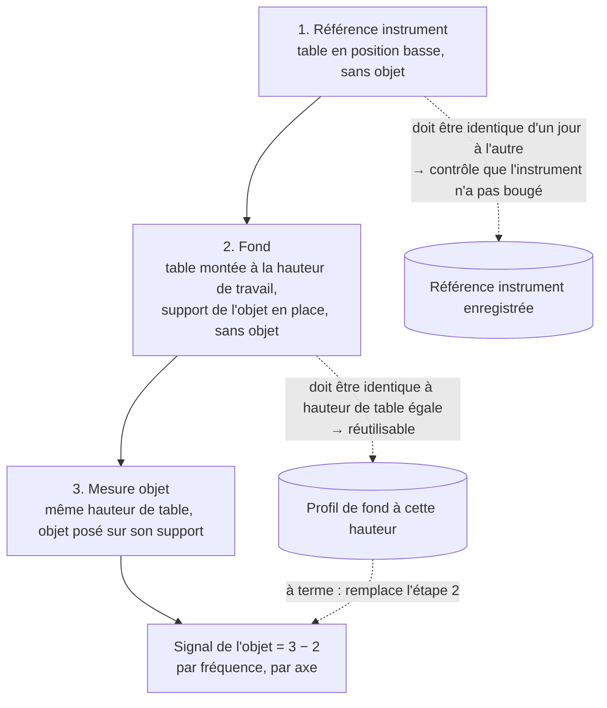
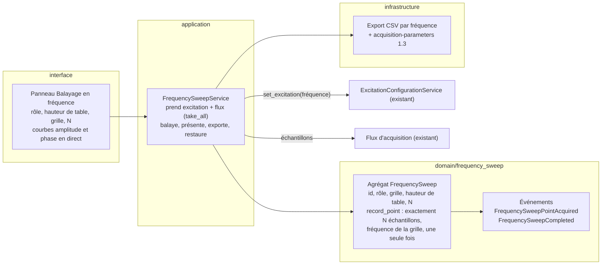

# Plan — Acquisition en fréquence

**État :** tranche 1 au banc le 2026-11-12 (un balayage court terminé et exporté) ; rôle « Mesure objet » ajouté (objet du registre + lift-off, exportés) — première moitié de la tranche 2, la différence objet − fond se fait encore à l'analyse. Le 2026-11-13 : grille en points par décade ou en liste de fréquences ; le fond se fait avec le support de l'objet en place.
**Prochaine action :** au banc, la chaîne complète : deux références instrument à la suite (superposition), un fond, une mesure objet à la même hauteur ; puis coder le choix du fond et la différence affichée (seconde moitié de la tranche 2). Constat du premier essai : à 100 Hz l'écart-type vaut un quart du signal (0,1 V pour 0,4 V), contre 0,0006 V à 10 kHz — revoir la borne basse ou N.

## Pourquoi

On veut la réponse du capteur en fonction de la fréquence d'excitation pour un objet, débarrassée de ce que le banc et la pièce ajoutent.
La méthode lente et robuste enchaîne trois balayages.
À terme, on veut caractériser assez bien l'environnement pour ne plus refaire que le balayage de l'objet, en rechargeant un fond déjà mesuré.
Il faut donc suivre, dès le premier balayage, tout ce qui conditionne la reproductibilité, et pouvoir combiner les fonds au fur et à mesure qu'ils s'accumulent.

## Le protocole

Chaque balayage a un **rôle** : référence instrument, fond, ou mesure objet.
Le rôle dit ce que la mesure caractérise ; il ne change pas la façon d'acquérir.

## Ce qu'un balayage acquiert

À une position XY fixe, pour chaque fréquence de la grille :

1. appliquer la fréquence au générateur (DDS1 à DDS4 partagent la fréquence) ;
2. attendre la stabilisation, puis collecter N échantillons acquis entièrement sous cette fréquence (même règle causale que la caractérisation du débit) ;
3. garder, par axe X, Y, Z : la moyenne et l'écart-type de I et de Q, en volts, **bruts** (sans la correction de champ primaire du capteur : c'est le fond qui joue ce rôle ici) ;
4. garder le décalage de phase de la référence de détection synchrone (DDS4 − DDS1) effectivement écrit à cette fréquence.

Le point 4 compte : la correction de phase est prise sur le point de calibration le plus proche en fréquence.
Si la calibration n'existe qu'à 1 kHz, toutes les fréquences reçoivent la correction de 1 kHz.
Le biais est le même dans le fond et dans la mesure objet, donc il s'annule dans la différence, mais il doit rester lisible dans l'export.

## Ce qu'on suit pour la reproductibilité

Le format d'export actuel (`acquisition-parameters.json`, schéma 1.2) porte déjà : excitation (mode, niveaux, phases), ADC (suréchantillonnage, gains), moyennage du microcontrôleur, calibrations appliquées, composants montés, position du banc, opérateur, objet mesuré et lift-off, version du code.

Il manque :

| Grandeur | Pourquoi | Où |
|---|---|---|
| Rôle du balayage | savoir si c'est une référence, un fond ou un objet | `procedure.frequency_sweep.role` |
| Hauteur de la table | un fond n'est réutilisable qu'à hauteur égale | `procedure.frequency_sweep.table_height` |
| Grille de fréquences, N par fréquence, délai de stabilisation | deux balayages ne se comparent que sur la même grille | `procedure.frequency_sweep` |
| Fond utilisé (mesure objet seulement) | savoir de quoi la différence a été faite | `procedure.frequency_sweep.background_sweep_id` |

Le schéma passe en 1.3 et l'activité gagne le type `frequency_sweep`.

Deux fonds sont **compatibles** (combinables, ou réutilisables pour un objet) quand ils ont la même grille, la même hauteur de table à la tolérance près, la même position XY, les mêmes réglages d'excitation et d'ADC, le même capteur et le même montage.
Cette règle se calcule depuis l'export : elle n'a pas besoin d'exister avant la tranche 4.

## Le modèle, dans l'architecture existante

- Un seul agrégat par balayage, qui contient ses points : un balayage dure quelques minutes et n'a de sens qu'entier. Le découpage « agrégat fin + points forts » du scan (ADR-004) répondait à des milliers de points et à la pause en milieu de ligne, on n'en a pas besoin.
- La mesure objet référence son fond par identité (`background_sweep_id`), comme le scan fin référence ses acquisitions. Pas d'agrégat « session » tant qu'on n'en a pas besoin.
- Le service suit la caractérisation du débit : réservation tout ou rien de l'excitation et du flux, paramètres d'acquisition écrits au démarrage puis à la fin, restauration de l'excitation de l'opérateur quoi qu'il arrive.

## Découpage en tranches

Chaque tranche se teste au banc avant la suivante ; un point = un commit = un retour.

1. **Un balayage de bout en bout.** Panneau (rôle, hauteur de table, grille, N), courbes en direct, export.
   Test au banc : deux balayages table basse à la suite se superposent à leur dispersion près. C'est le premier contrôle de reproductibilité.
2. **Mesure objet contre un fond.** On choisit le fond (par défaut le dernier fond à la même hauteur), la différence par fréquence et par axe s'affiche et s'exporte avec l'identifiant du fond.
3. **Référence instrument.** On marque un balayage table basse comme référence ; chaque nouveau balayage table basse lui est comparé, fréquence par fréquence, et le verdict (conforme ou écart) s'affiche.
4. **Profil de fond.** Les fonds compatibles se combinent (moyenne et dispersion entre balayages), et un profil se charge pour une mesure objet sans refaire le fond.

## Choix pris sur recommandation

- I et Q bruts, sans correction de champ primaire : le fond fait ce travail, et la correction reste possible à l'analyse.
- Grille, au choix de l'opérateur (demande du 2026-11-13) : des points par décade entre deux bornes (défaut 10 par décade de 100 Hz à 10 kHz, soit 21 fréquences), ou une liste de fréquences saisie. Les points par décade sont ancrés sur les puissances de 10 (10^(k/n) Hz), pas sur les bornes : deux balayages de même densité partagent leurs fréquences communes, ce qui permet de soustraire et combiner des fonds acquis sur des plages différentes. Une liste est balayée par ordre croissant, un doublon est refusé.
- Fond avec le support de l'objet en place (demande du 2026-11-13) : la différence objet − fond ne garde alors que l'objet.
- Délai de stabilisation après chaque changement de fréquence : 0,5 s par défaut, réglable, exporté.

## Hauteur de la table (tranché le 2026-11-12)

L'opérateur saisit la **hauteur de la table**, en mm, telle qu'il la lit sur le panneau de commande de la table.
Le logiciel ne sait que ça : la valeur est donnée par l'opérateur.
C'est une grandeur distincte du lift-off de l'objet (sphères ↔ sommet de l'objet), qui reste dans `feature_of_interest` et ne concerne que la mesure objet.

## Le protocole complet reste toujours disponible

Le profil de fond (tranche 4) est un raccourci, jamais un remplacement : les trois balayages restent proposés pour une mesure très propre, par exemple pour une publication.
