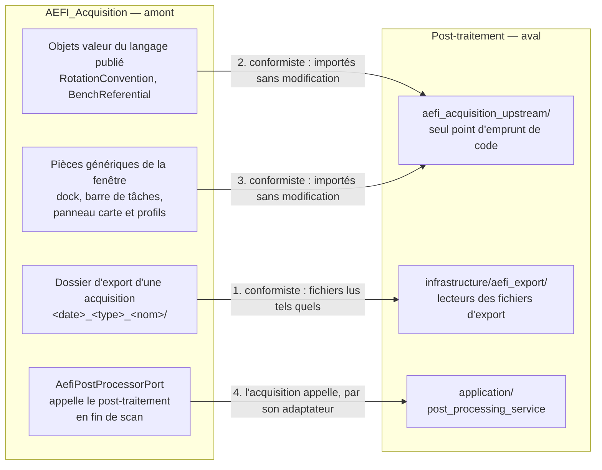

# Conception — le post-traitement en panneaux, conforme à AEFI_Acquisition

## Ce qu'on veut

Le post-traitement (`external_modules/aefi_post_processor_module/`) est aujourd'hui une fenêtre fixe à trois zones, sans couches.
On le refait sur le modèle du logiciel d'acquisition : une fenêtre à panneaux déplaçables avec une barre de tâches, et les quatre couches DDD (domaine, application, infrastructure, interface) avec leurs conventions.

On part de la conformité : la première tranche ne change aucun résultat, elle range le code existant dans la bonne architecture.
Les fonctionnalités viennent ensuite, une tranche par fonctionnalité (voir `recits utilisateurs - post-traitement.md`).

## 1. La relation avec AEFI_Acquisition

Le post-traitement est en **aval** d'AEFI_Acquisition, dans une relation **conformiste**.
Il adopte le modèle de l'amont tel quel, sans couche de traduction.
Il le rencontre par trois voies, et l'acquisition le rencontre par une quatrième, en sens inverse.



### 1.1 Le dossier d'export, langage publié de l'acquisition

Le contrat entre les deux logiciels est le dossier d'export, pas le code de l'acquisition.
Le post-traitement en lit le sens dans les fichiers eux-mêmes : `data.columns` décrit chaque colonne du CSV, avec son unité et son repère.

| Objet produit par l'acquisition | Ce que le post-traitement en lit | Aujourd'hui | Cible |
|---|---|---|---|
| `<scan>_aefi.csv` | positions `x`, `y` (mm, repère `bench`, origine aux butées) ; tensions I et Q par axe (V, repère du capteur) | lu | lu, colonnes vérifiées contre `data.columns` |
| `<scan>_acquisition-parameters.json`, schéma `aefi-acquisition-parameters` 1.x | `provenance.activity.id` (identité de l'acquisition), `procedure` (pas à pas, à la volée, balayage en fréquence ; grille), `feature_of_interest` (objet, lift-off), `measurement_chain.sensor.deployment.rotation_applied` (angles, convention, origine, calibration), `measurement_chain.positioning.state` (repère, course des axes), `warnings`, `data.files` (empreintes) | **non lu** | lu : c'est la source des angles et du référentiel |
| `<scan>.h5` | créé et pris en empreinte par l'acquisition ; le post-traitement y ajoute ses étapes | modifié | à trancher, point 1 |
| `<scan>_events.jsonl`, `<scan>_logs.log` | rien au départ | non lus | non lus |
| `.aefi_acquisition/configs/export_default_config.json` | `output_directory` : où chercher les exports | lu | lu |
| `config_templates/aefi_device_config.json` | angles idéaux du capteur | lu à chaque retraitement | lu seulement si l'export ne porte pas `rotation_applied`, et dit comme tel dans le journal |

Règles du conformisme sur les fichiers :

- Les noms de l'amont restent ceux du post-traitement : `bench`, `limit_switch` et `centered`, `rotation_applied`, une grandeur `{value, unit}` en UCUM, `provenance.activity.id` comme identité. Aucun renommage.
- La version majeure 1 du schéma est acceptée. Une version inconnue est refusée et nommée dans le journal ; l'acquisition apparaît alors « format non pris en charge » dans le catalogue.
- La convention de rotation est lue dans le fichier, et seule celle que l'application applique est acceptée (`extrinsic`, `ZYX`, `sources_to_sensor`, soit P = Rx·Ry·Rz). Toute autre est refusée, comme dans l'application.
- Un changement de format côté acquisition se répercute dans le post-traitement. Il n'a pas à l'absorber : c'est le prix assumé du conformisme, et ce qui garde un seul vocabulaire pour les deux logiciels.

### 1.2 Les objets de code empruntés

Le post-traitement réutilise du code de l'acquisition plutôt que de le recopier : un concept garde un seul nom et une seule implémentation.
Tout emprunt passe par un seul paquet, `aefi_acquisition_upstream/`, dont l'intention liste chaque objet emprunté, sa source et pourquoi.

| Objet emprunté | Source dans l'acquisition | Usage dans le post-traitement |
|---|---|---|
| `RotationConvention` | `src/domain/test_bench/calibration/value_objects/rotation_convention/` | valider la convention lue dans l'export |
| `BenchReferential` | `src/interface/presentation/bench_referential.py` | convertir l'affichage entre butées et centré, avec la course de chaque acquisition |
| `WindowsCarrier`, `CarrierPresentationModel` | `src/interface/widgets/carrier/`, `src/interface/presentation/` | les panneaux déplaçables |
| `ModernTaskbar`, `TaskbarPresenter`, `TaskbarPresentationModel` | `src/interface/widgets/taskbar/`, `src/interface/presenters/`, `src/interface/presentation/` | la barre de tâches |
| `ScanVisualizationPanel` | `src/interface/widgets/panels/` | les panneaux Carte et Profils, identiques à ceux de l'application |

Règles des emprunts :

- Seuls les objets **sans dépendance** sont empruntables : objets valeur purs et pièces génériques de l'interface, qui n'importent ni service, ni port, ni adaptateur. Chacun a été vérifié à la conception.
- Jamais un service applicatif, un port, un adaptateur ni un agrégat de l'acquisition : le post-traitement ne pilote rien.
- Les couches du post-traitement importent ces objets depuis `aefi_acquisition_upstream/`, jamais directement depuis `src/`. Un emprunt qui casse se répare à un seul endroit.
- Le post-traitement garde ses propres fichiers d'état : sa disposition de panneaux ne réécrit pas `~/.aefi_acquisition_layout.dat`.

### 1.3 L'acquisition appelle le post-traitement

En fin de scan, l'acquisition calcule le `.h5` par son adaptateur `src/infrastructure/post_processing/aefi_post_processor_port.py`, avec les angles de la calibration active.
Côté acquisition, cet adaptateur est la seule couche anticorruption face au post-traitement.
Aujourd'hui il appelle directement `ProcessingPipeline` ; à terme, il appellera le service `IApiPostProcessingService`, l'entrée publique du post-traitement.

Contrainte qui en découle : le domaine et l'application du post-traitement n'importent **ni Qt, ni** `aefi_acquisition_upstream/`.
Sinon l'acquisition importerait, à travers lui, du code de sa propre interface : un import circulaire.
Seules l'infrastructure et l'interface du post-traitement empruntent.

## 2. Les couches

Même découpage et mêmes conventions que `src/` : une intention par fichier, le trio des services applicatifs, ports entrants `i_api_` et sortants `ports/`, doublures dans `fake/`, tests dans `_tests/`, aucun import du domaine dans les panneaux.

```text
aefi_post_processor_module/
  main.py                          racine de composition (remplace composition_root.py et les deux lanceurs de visualisation)
  aefi_acquisition_upstream/       seul point d'emprunt de code (§ 1.2)
  domain/
    acquisition_record/            l'acquisition telle que l'export la décrit, en lecture seule
      acquisition_record.py        identité AcquisitionId (= provenance.activity.id), type, objet, lift-off
      value_objects/               SensorRotation (angles + convention + origine), BenchExtent (course des axes)
    processing/                    les calculs, purs et déterministes
      field_map.py                 grille, étendue, canaux
      services/                    mise en grille, calibration de phase, soustraction du champ primaire,
                                   changement de repère, interpolation (déplacés depuis processing/)
      value_objects/               ProcessingStepName (ensemble fermé), ProcessingParameters
      errors/
  application/services/
    acquisition_catalog_service/   lister les acquisitions et leur état ; trio + ports + _tests
    post_processing_service/       traiter une acquisition ou toutes celles à recalculer, à la demande ; bilan
    field_map_service/             charger une étape d'une acquisition pour l'afficher
  infrastructure/
    aefi_export/                   lecteurs du dossier d'export : CSV, paramètres d'acquisition 1.x
    persistence/hdf5/              écriture et lecture des étapes (l'actuel DataHandler)
    logging/                       configuration du journal (étape 1, déplacée)
    */fake/                        doublures, avec les mêmes échecs que les vraies
  interface/
    shell/                         dashboard.py et dashboard_wiring.py, comme l'application
    presenters/                    signaux Qt seulement
    view_models/
    widgets/panels/                un fichier et une intention par panneau
```

Le calcul est du domaine : une règle déterministe sans entrée ni sortie se range dans le domaine, quel que soit son type de fichier.
L'agrégat `AcquisitionRecord` est en lecture seule : le post-traitement ne crée ni ne modifie d'acquisition.
Pas d'événements de domaine au départ : il n'y a ni magasin d'événements ni consommateur ; le journal suffit à suivre les traitements.

## 3. Les panneaux

| Panneau | Ce qu'il montre | Réutilise | Groupe |
|---|---|---|---|
| Acquisitions | les acquisitions du dossier d'export, leur type, objet, lift-off et état (traitée, à recalculer, en échec, format non pris en charge) ; le bouton qui lance le traitement | — | Données |
| Paramètres d'acquisition | la fiche de l'acquisition choisie : opérateur, objet, capteur, angles appliqués et leur origine, référentiel, avertissements de l'export | — | Données |
| Carte | une étape du traitement en cartes de couleur, une voie ou toutes, dans le référentiel choisi | `ScanVisualizationPanel` | Visualisation |
| Profils | des coupes à X ou Y fixe, cochées une à une | `ScanVisualizationPanel(profiles=True)` | Visualisation |
| Logs | le journal (étape 1), avec l'ouverture du fichier journal | — | Système |
| Settings | le référentiel d'affichage, butées ou centré | — | Système |

Choisir une acquisition dans le panneau Acquisitions met à jour les trois autres panneaux de données et de visualisation.

## 4. Les tranches

Chaque tranche est un commit, testée seule, et vérifiée par l'humain avant la suivante.

1. **Conformité de base.** Ranger le code existant dans les quatre couches, créer `aefi_acquisition_upstream/`, la fenêtre à panneaux (Acquisitions, Carte, Logs). Mêmes résultats, mêmes fichiers produits ; les tests existants passent toujours.
2. **Lecture des paramètres d'acquisition.** Les vrais angles et leur convention au retraitement ; le panneau Paramètres d'acquisition.
3. **Référentiel centré.** Settings et curseur, avec la course de chaque acquisition.
4. **Profils.**
5. **Les deux tests de calcul en échec** : l'écart de 180° de la calibration de phase et la soustraction d'amplitude.
6. **Côté acquisition** : `AefiPostProcessorPort` appelle `IApiPostProcessingService` au lieu du pipeline. Seule tranche qui touche `src/`.

## 5. Points à trancher

1. **Où vivent les étapes calculées ?** Aujourd'hui, le post-traitement écrit ses étapes dans le `.h5` que l'acquisition a créé et pris en empreinte (`data.files`) : l'empreinte ne correspond plus au fichier, et l'aval modifie un objet de l'amont.
   **Recommandation :** un fichier propre au post-traitement, `<scan>_post-processing.h5`, à côté. L'empreinte de l'acquisition reste vraie. Cela touche aussi l'adaptateur de l'acquisition (tranche 6).
2. **Le traitement automatique au lancement.** Aujourd'hui, ouvrir le post-traitement recalcule seul les acquisitions nouvelles ou plus récentes, avant même d'afficher la fenêtre.
   **Recommandation :** le lancement montre seulement l'état de chaque acquisition ; le traitement part du bouton du panneau Acquisitions, avec son bilan dans Logs. Le traitement en fin de scan, décidé par l'acquisition, ne change pas.
3. **Emprunter le code par import ou le recopier.**
   **Recommandation :** l'import par `aefi_acquisition_upstream/` (§ 1.2), qui garde un seul nom par concept.
