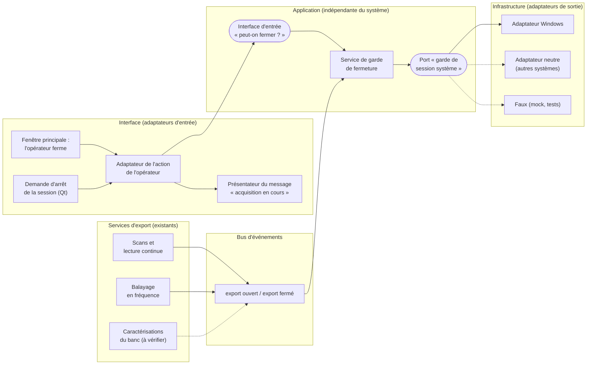
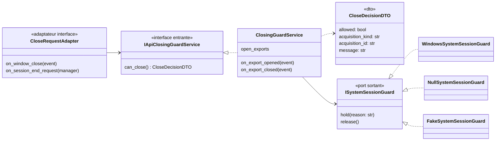
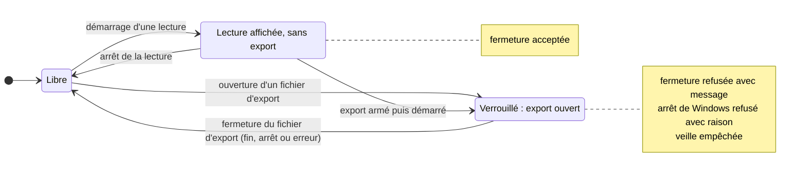
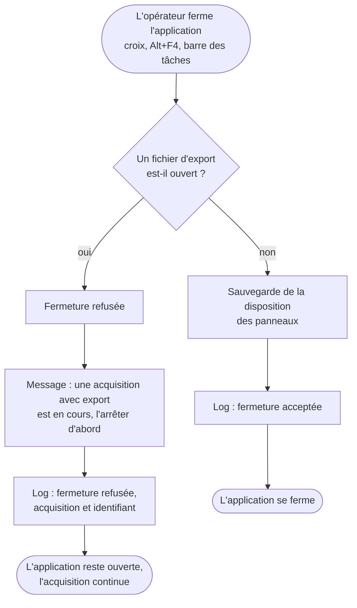
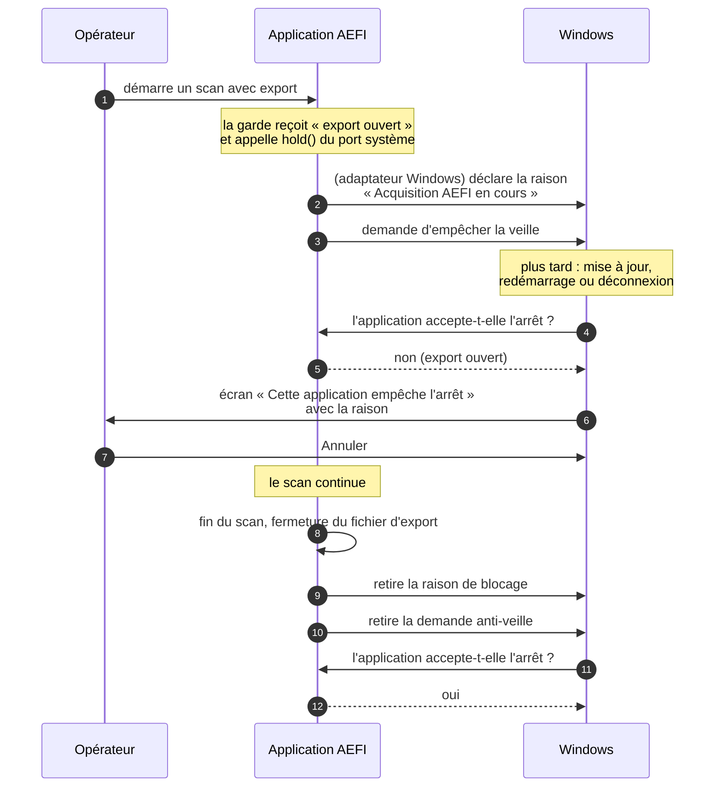
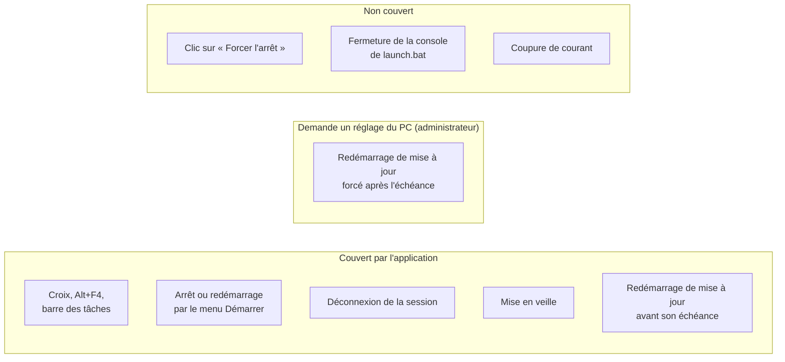
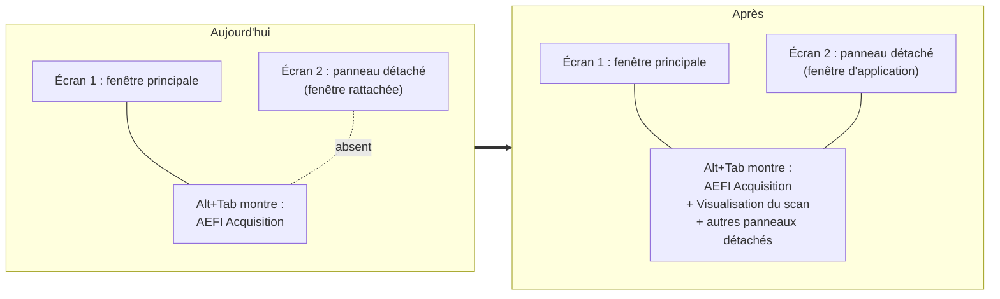
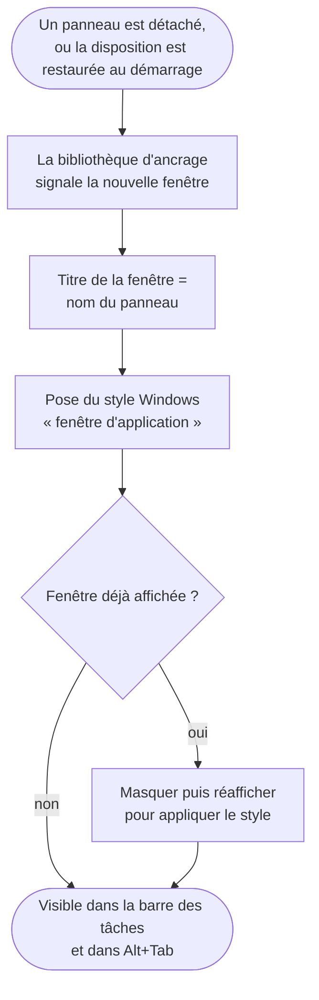
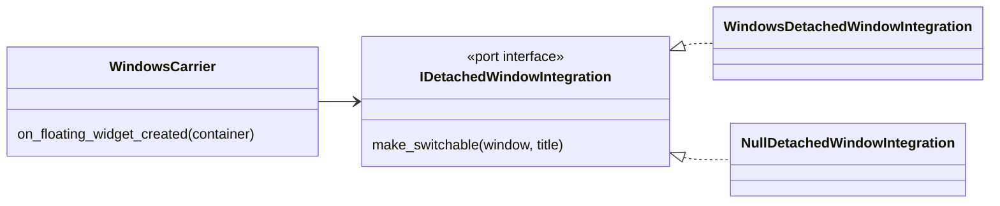
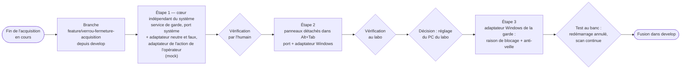

# Plan — Verrou de fermeture pendant une acquisition, et panneaux détachés visibles dans Alt+Tab

**État :** plan rédigé le 2026-11-14 sur le PC du labo, pendant une acquisition réelle. Rien n'est codé, rien n'a été lancé.
**Prochaine action :** une fois l'acquisition en cours terminée, créer `feature/verrou-fermeture-acquisition` depuis `develop` et coder l'étape 1 (le cœur indépendant du système et l'adaptateur de l'action de l'opérateur, avec le message), testable en mode mock.

## Pourquoi

Une acquisition réelle dure des heures. Si l'application se ferme pendant qu'elle écrit son fichier d'export, la mesure est perdue ou tronquée. Deux causes possibles : un opérateur qui ferme la fenêtre, ou Windows qui redémarre pour une mise à jour.

L'humain, le 2026-11-14 :

> mettre un verrouillage sur l'application pour ne pas qu'elle soit fermée quand elle est en cours d'acquisition (si possible même par windows s'il veut faire une mise à jour, on lui refuse et il doit attendre la fin). Si un utilisateur veut fermer l'application il doit recevoir un message pop up lui expliquant qu'une acquisition est en cours et qu'il doit d'abord stopper toute acquisition avant de fermer l'application. Par acquisition j'entends une acquisition avec export en cours, pas seulement une lecture de données dans l'interface.

Et, sur les écrans multiples :

> quand je sépare les panneaux de l'interface pour les mettre sur 2 écrans, j'aimerais que windows m'affiche ces 2 écrans dans le ctrl + tab

## Partie 1 — Verrou de fermeture

### Ce qui déclenche le verrou

Le verrou est actif quand **un fichier d'export est ouvert**, et seulement alors. Une lecture continue affichée sans export armé ne verrouille rien.

Les services savent déjà qu'un export est ouvert, il n'y a pas d'état à inventer :

- le service d'export des scans (`scan_export_service.py`) garde la liste de ses fichiers ouverts, remplie au démarrage d'un scan avec export ou d'une lecture continue avec export temporel armé, et vidée à la fermeture de l'export ;
- le service du balayage en fréquence (`frequency_sweep_service.py`) garde l'emplacement de son export ouvert ;
- les caractérisations du banc d'essai (débit d'acquisition, cadence de sortie du convertisseur) exportent aussi : à inclure si elles écrivent pendant une durée longue, à vérifier au codage.

### Architecture : un cœur indépendant du système, des adaptateurs autour

Décision de l'humain (2026-11-14) : le verrou est **indépendant du système d'exploitation**. Ce qui est propre à Windows vit dans un adaptateur Windows, et l'action de l'opérateur dans l'interface passe par son propre adaptateur.

Trois morceaux :

1. **Le service de garde de fermeture** (couche application, indépendant du système). Il sait quels exports sont ouverts et répond à une seule question : « l'application peut-elle se fermer maintenant ? », avec, en cas de refus, la raison (quelle acquisition, quel identifiant). Il prévient le système au début du premier export ouvert et à la fin du dernier.
   - Il ne questionne pas les services d'export (un service applicatif n'en appelle pas un autre). Les services d'export **publient** « export ouvert » et « export fermé » sur le bus d'événements, et la garde s'y abonne.
   - Il suit le trio des services applicatifs : `intention.md`, interface d'entrée `i_api_closing_guard_service.py`, `dtos/`, `closing_guard_service.py`, `ports/`, `_tests/`.
2. **Le port vers le système d'exploitation** (« garde de session système »), déclaré dans `ports/` du service : `retenir(raison)` empêche l'arrêt de la session et la veille, `relacher()` les rend. Ses adaptateurs, en infrastructure :
   - **adaptateur Windows** : raison de blocage affichée par Windows à l'arrêt, demande anti-veille ;
   - **adaptateur neutre** pour les autres systèmes : n'empêche rien, logue « garde de session non prise en charge sur ce système » ;
   - **faux** pour le mode mock et les tests, qui enregistre les appels.
   Linux (inhibiteur de session) et macOS (assertion d'alimentation) auraient chacun leur adaptateur derrière le même port, à écrire seulement si l'application tourne un jour sur ces systèmes.
3. **L'adaptateur de l'action de l'opérateur** (couche interface). Il reçoit les deux demandes de fermeture : l'opérateur qui ferme la fenêtre, et le système qui demande l'arrêt de la session (Qt transmet cette demande de la même façon sous Windows, Linux et macOS). Il demande au service s'il peut fermer, puis applique la réponse : accepter, ou refuser et afficher le message par son présentateur. Il ne contient aucune règle.

L'adaptateur concret du système est choisi une fois, à l'assemblage dans `main.py`, selon le système (Windows ou autre) et le mode (réel ou mock).

Les contrats, en noms de code proposés :

Le verrou suit la vie de l'export, pas celle de l'affichage :

### Étape 1 — Refuser la fermeture par l'opérateur, avec un message

Cette étape pose le cœur : le service de garde, son port vers le système avec l'adaptateur neutre et le faux, la publication « export ouvert / fermé » par les services d'export, et l'adaptateur de l'action de l'opérateur. Elle n'écrit rien de propre à Windows.

La fenêtre principale (`dashboard.py`, méthode de fermeture qui sauvegarde aujourd'hui la disposition puis accepte) passe la demande à l'adaptateur de l'action de l'opérateur, qui demande au service avant d'accepter :

- export ouvert : la fermeture est refusée, et une fenêtre de message s'affiche :
  « Une acquisition avec export est en cours (scan 2D, objet X). Arrêtez d'abord toute acquisition avant de fermer l'application. »
- aucun export : comportement actuel (sauvegarde de la disposition, fermeture).

Couvre la croix de la fenêtre, Alt+F4 et la fermeture depuis la barre des tâches. Vérifier au codage qu'aucun autre chemin ne quitte l'application sans passer par là (menu, raccourci, `app.quit()` direct).

Le refus est logué avec l'acquisition en cours et son identifiant ; une fermeture acceptée aussi.

Test : en mode mock, démarrer un scan avec export, cliquer la croix, vérifier le message et que l'application reste ouverte ; arrêter le scan, fermer, vérifier que l'application se ferme. Tests automatiques : le service seul (exports ouverts et fermés, décision, appels au faux du port système) ; le parcours de l'opérateur dans la vraie composition (clic sur la croix jusqu'au service, après `gc.collect()`).

La demande d'arrêt de la session passe déjà par l'adaptateur de l'action de l'opérateur dès cette étape : sur tout système, l'application refuse l'arrêt tant qu'un export est ouvert. Seule la raison affichée par Windows et l'anti-veille attendent l'adaptateur Windows.

### Étape 3 — L'adaptateur Windows : raison de blocage et anti-veille

Quand Windows s'arrête, redémarre ou déconnecte la session, il demande d'abord aux applications si elles acceptent. Qt transmet cette demande à l'application ; elle peut l'annuler (fait à l'étape 1). L'adaptateur Windows ajoute ce que seul Windows sait faire :

- export ouvert : l'application annule la demande, et déclare à Windows une raison de blocage (« Acquisition AEFI en cours — attendre la fin de l'export »). Windows affiche alors son écran « Cette application empêche l'arrêt » avec ce texte, et l'opérateur choisit « Annuler ».
- la raison de blocage est déclarée au début de l'export et retirée à sa fin, pour que l'écran de Windows dise toujours la vérité.

Les appels à Windows vivent dans l'adaptateur Windows du port « garde de session système » (`hold` déclare la raison et l'anti-veille, `release` les retire). Le service et l'adaptateur de l'action de l'opérateur ne changent pas : seul l'assemblage dans `main.py` choisit l'adaptateur Windows au lieu de l'adaptateur neutre.

Dans la même étape, empêcher la mise en veille de l'ordinateur pendant l'export (même mécanisme de Windows, demande retirée à la fin de l'export) : une veille interromprait l'acquisition aussi sûrement qu'un redémarrage.

Test au banc, une fois une acquisition réelle terminée : lancer un scan court avec export, demander un redémarrage par le menu Démarrer, vérifier que l'écran de Windows montre la raison, cliquer « Annuler », vérifier que le scan continue.

### Limite : ce qu'une application ne peut pas refuser

Une application peut refuser un arrêt normal, mais pas tout :

- sur l'écran de blocage, un clic sur « Forcer l'arrêt » ferme l'application ;
- un redémarrage de mise à jour forcé, une fois passée l'échéance que Windows s'est fixée, peut ignorer le refus.

Pour fermer cette porte, le réglage se fait sur la machine, pas dans l'application : par exemple la stratégie « Pas de redémarrage automatique avec des utilisateurs connectés », ou des heures d'activité couvrant les acquisitions. Ce réglage demande les droits administrateur du PC du labo : **à trancher avec l'humain** avant l'étape 3 (le faire, par qui, lequel).

L'application ne mettra pas les mises à jour en pause d'elle-même : ce serait un comportement caché.

### Point annexe — le lancement

`launch.vbs` (le raccourci) lance l'application sans fenêtre console. `launch.bat` ouvert directement garde une console : la fermer tue l'application sans aucune demande, donc sans verrou. Rappeler dans le mode d'emploi de lancer par le raccourci.

## Partie 2 — Panneaux détachés dans Alt+Tab

Sous Windows, le sélecteur de fenêtres est **Alt+Tab** (Ctrl+Tab change d'onglet à l'intérieur d'une application ; Windows+Tab ouvre la vue des tâches). La demande porte sur Alt+Tab.

C'est possible. Aujourd'hui un panneau détaché est une fenêtre « rattachée » à la fenêtre principale par la bibliothèque d'ancrage (PySide6-QtAds) ; Windows masque les fenêtres rattachées de la barre des tâches et d'Alt+Tab. Pour qu'il les montre, chaque fenêtre détachée reçoit le style Windows « fenêtre d'application ».

- La bibliothèque signale la création de chaque fenêtre détachée (signal `floatingWidgetCreated` du gestionnaire d'ancrage, présent dans la version installée). À ce signal, on pose le style sur la fenêtre.
- Le titre de la fenêtre dans Alt+Tab est celui du panneau (option de la bibliothèque qui reprend le titre du panneau détaché).
- Vérifier au codage que les fenêtres détachées recréées au démarrage par la restauration de la disposition émettent aussi le signal, sinon poser le style après la restauration.
- Le style Windows ne prend effet que s'il est posé avant l'affichage de la fenêtre, ou suivi d'un masquage puis réaffichage : à vérifier sur le PC.

Même séparation que la partie 1. Rendre une fenêtre visible dans le sélecteur du système est une affaire de fenêtres, donc de la couche interface, pas de l'application :

- un port « intégration des fenêtres détachées au système » (`make_switchable(fenêtre, titre)`), dans la couche interface ;
- un **adaptateur Windows** qui pose le style « fenêtre d'application » ;
- un **adaptateur neutre** pour les autres systèmes, qui ne fait rien et le logue ;
- le gestionnaire de panneaux (`windows_carrier.py`) appelle le port à chaque fenêtre détachée créée, sans savoir sur quel système il tourne.

Test au banc : détacher deux panneaux sur le second écran, Alt+Tab, vérifier que chacun apparaît avec son nom et que le choisir l'amène au premier plan ; fermer et rouvrir l'application, vérifier que les panneaux restaurés apparaissent aussi.

## Ordre et façon de travailler

Une étape = un commit = une vérification par l'humain :

1. le cœur indépendant du système : service de garde de fermeture, port vers le système avec adaptateur neutre et faux, publication « export ouvert / fermé », adaptateur de l'action de l'opérateur avec le message (mock d'abord) ;
2. panneaux détachés dans Alt+Tab : port d'intégration des fenêtres et son adaptateur Windows (petit, indépendant, vérifiable vite au labo) ;
3. l'adaptateur Windows de la garde de session (raison de blocage, anti-veille), après décision sur le réglage de la machine.

Rien ne se code ni ne se teste dans `C:\Users\manip\AEFI_Acquisition` (le dossier des acquisitions réelles), et rien ne se lance pendant une acquisition.
