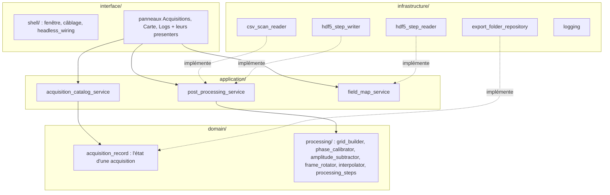
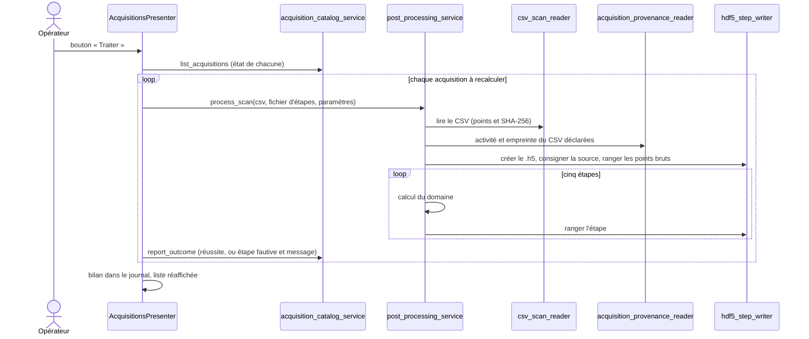

# Architecture du post-traitement AEFI

Le post-traitement transforme le CSV d'un scan en cinq étapes calculées, rangées dans un `.h5` qu'il crée à côté du CSV de l'acquisition (qui n'exporte que des CSV), et les montre dans une fenêtre à panneaux.
Il suit les couches de l'acquisition. Le détail de chaque atome est dans son `<nom>_intention.md`, à côté de son code.

## Couches



Le sens des dépendances : l'interface et l'infrastructure importent l'application, l'application importe le domaine, le domaine n'importe que la bibliothèque standard et numpy/scipy. `_tests/architecture_test.py` le vérifie (ni `PySide6`, `pandas`, `h5py`, `pathlib`, ni l'acquisition dans `domain/` et `application/`).
`aefi_acquisition_upstream/` est le seul endroit qui emprunte du code à `src/` (fenêtre à panneaux, barre de tâches) : il règle `sys.path` et liste ce qu'il emprunte.

## Les cinq étapes

| Étape | Atome (`domain/processing/`) | Ce qu'il fait |
|---|---|---|
| `preprocessed` | `grid_builder` | CSV d'un scan, même incomplet, en grille carrée complétée de NaN, avec l'étendue |
| `phase_calibrated` | `phase_calibrator` | angle moyen θ = mean(atan2(Q, I)) sur le bord, rotation de −θ de toute l'image |
| `amplitude_subtracted` | `amplitude_subtractor` | moyenne du bord (NaN ignorés) retranchée à tous les pixels |
| `rotated_frame` | `frame_rotator` | rotation par quaternion du repère du capteur au repère des sources, angles de montage P = Rx·Ry·Rz ; les angles sont ceux que l'acquisition a appliqués (fichier des paramètres), à défaut les angles idéaux du gabarit |
| `interpolated` | `interpolator` | grille plus fine, `linear`, `cubic` ou `nearest`, NaN respectés |

Les noms et l'ordre sont fermés dans `processing_steps` ; les paramètres (largeur du bord, méthode, taille de grille, point de référence, angles) y sont gelés.

## Traiter une acquisition



Une acquisition qui échoue ne stoppe pas les suivantes ; son échec nomme l'étape fautive.
Le fichier d'étapes est le `.h5` du dossier de l'acquisition, `<dossier>/<nom du dossier>.h5` (`processing_store_path`). L'acquisition ne l'écrit plus : le post-traitement le crée au premier traitement et le complète ensuite, sans toucher au CSV.

## L'état d'une acquisition

`AcquisitionRecord` décide, sans rien écrire :
- **à recalculer** si le fichier d'étapes manque, s'il ne contient pas `preprocessed`, si le CSV est plus récent que le fichier d'étapes, ou si le recalcul est forcé ;
- **traitée** sinon ;
- **en échec** pour une acquisition dont le traitement a échoué dans la session, avec son message.

Le catalogue liste ces états à l'ouverture et n'écrit aucun fichier : c'est ce que garde `_tests/launch_test.py`, en lançant la fenêtre dans un processus neuf.

## Structure du `.h5`

```
<acquisition>.h5
├── /preprocessed          data [N×N×6], attrs : extent, grid_size, channel_names, timestamp
├── /phase_calibrated      data [N×N×6], attrs : phase_angles, timestamp
├── /amplitude_subtracted  data [N×N×6], attrs : mean_amplitudes, timestamp
├── /rotated_frame         data [N×N×6], attrs : rotation_angles, quaternion, rotation_matrix, timestamp
└── /interpolated          data [M×M×6], attrs : interpolation_method, quality_metrics, timestamp
```

Chaque `.h5` créé par le post-traitement porte aussi, en plus des étapes :

```
├── /raw_scan              positions [n×2], values [n×6], attrs : channel_names   (les points relus du CSV, pas une étape)
└── attributs de la racine : source_csv, source_sha256, source_activity_id, source_declared_sha256,
                             source_sha256_matches, load_timestamp, processing_history
```

- `source_sha256` est l'empreinte des octets du CSV lus ; `source_declared_sha256` celle que l'acquisition a consignée dans `data.files` de son fichier de paramètres, `source_activity_id` son `provenance.activity.id`. `source_sha256_matches` dit si les deux sont égales : faux, le CSV n'est plus celui que l'acquisition a fermé (avertissement `pipeline.source_changed`), le traitement a lieu quand même. Absents quand le fichier des paramètres ne les dit pas.
- Les points de la sonde de champ restent dans leur CSV d'accompagnement : le `.h5` ne les recopie pas.
- Un `.h5` d'une acquisition antérieure à ce changement (écrit par l'acquisition, avec `/scan_data`) se complète de la même façon ; `raw_scan` s'y ajoute sans toucher à ses groupes.

Les six canaux sont les tensions en phase et en quadrature de x, y et z.

## Tests

- **Étalon** (`_tests/golden_master_test.py`) : trois scans synthétiques traités par le service, chaque étape comparée octet pour octet à `_tests/golden/` (`np.array_equal`, NaN égaux). Il ne change qu'avec une décision sur les chiffres.
- **Atomes** : chaque dossier de `domain/processing/` a son `_tests/`, avec des fonctions analytiques à résultat connu (phase décalée, fond constant, rotation, convergence O(h²) en linéaire et O(h⁴) en cubique, grille incomplète).
- **Adaptateurs** : chaque adaptateur a son Fake et une suite de contrat que le réel et le Fake passent.
- **Presenters** : testés avec une vue Fake, le vrai catalogue et le vrai service sur des Fakes.
- **Lancement** (`_tests/launch_test.py`) : `composition_root.py` en sous-processus, Qt hors écran.
- **Le `.h5` naît du CSV seul** (`_tests/h5_created_from_the_csv_alone_test.py`) : un dossier avec le CSV et son fichier de paramètres, sans `.h5`, donne le `.h5` complet (cinq étapes, points bruts, source), avec une empreinte égale à celle du fichier des paramètres.
- **Côté acquisition** : `src/infrastructure/aefi_post_processor_port`, `scan_export_with_post_processing_integration_test.py` (un scan simulé exporté, un seul CSV, aucun `.h5` avant le traitement, puis le `.h5` du traitement avec la provenance) et `external_modules_panel_test.py` figent l'appel de l'adaptateur et le fichier produit.

Deux tests de calcul échouent depuis avant la refonte (écart de 180° sur x et y : `test_phase_recovery`, `test_offset_removal`) ; ils attendent la tranche 5.

## Diagrammes

`diagrams/class_diagrams.puml` (classes des couches), `diagrams/test_*.puml` (stratégie de test analytique). `diagrams/sequence_diagrams.puml` décrit l'analyse du bruit, pas le post-traitement.
